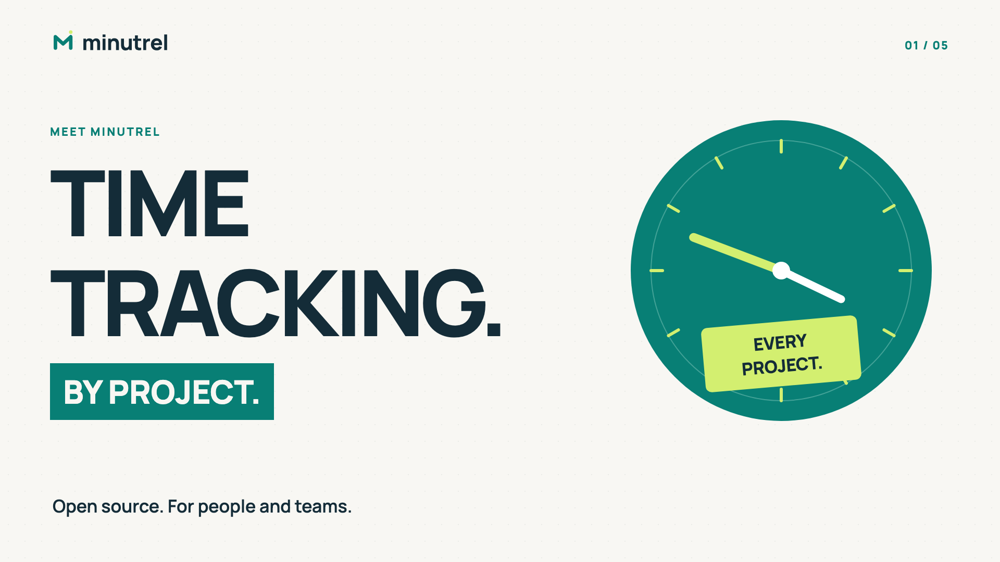

# Minutrel — V0.1

Le temps de vos projets, ensemble. Application libre **AGPL-3.0-or-later**, autohébergée, pour suivre le travail d’une équipe depuis le navigateur ou un client macOS, Windows et Linux.

La V0.1 propose un **client ordinateur autonome**, utilisable sans serveur ni compte en ligne, et un **espace d’équipe autohébergé** partagé avec le web. Comptes et rôles, projets, chronomètres, travail hors connexion avec file d’envoi, saisies manuelles, notes, rapports CSV/PDF/ZIP, API, webhook entrant et MCP sont inclus. L’interface est disponible en **français, anglais et allemand**.

Les clients utilisent Tauri et la WebView du système. Le serveur commun conserve les données d’équipe dans SQLite. L’espace personnel et la file locale restent sur l’ordinateur ; la connexion à l’équipe est facultative.

**Guides illustrés : [Français](docs/guide/fr/README.md) · [English](docs/guide/en/README.md) · [Deutsch](docs/guide/de/README.md).**

## Découvrir Minutrel en vidéo

[](https://youtu.be/q6VeUbyOhn8)

[Présentation](https://youtu.be/q6VeUbyOhn8) · [Fonctionnement et premiers pas](https://youtu.be/u5MItUvsxQc) · [Playlist YouTube](https://www.youtube.com/playlist?list=PLR7Pc9PfnKIk)

Les **12 vidéos en anglais**, avec voix, musique originale et sous-titres, sont répertoriées dans la [vidéothèque](docs/VIDEOS.md) et son [English catalog](docs/VIDEOS.en.md). Les douze vidéos sont publiques sur YouTube ; les guides assistants et autohébergement proposent aussi un téléchargement MP4. Les exemples utilisent des données fictives de la préversion V0.1.

## Essayer en local

Installer Node.js **24** (version verrouillée dans [.nvmrc](.nvmrc)), puis :

```sh
npm ci --ignore-scripts
npm run demo
```

Ouvrir **http://127.0.0.1:8080**. Les identifiants aléatoires de la démonstration sont dans `.cache/demo/access.json`. Les données sont fictives et isolées dans `.cache/demo/`. Aucun service IA n’est sollicité. Arrêter avec `Ctrl+C`.

## Créer votre propre espace

```sh
npm ci --ignore-scripts
npm run build
npm start
```

Ouvrir **http://127.0.0.1:8081**, puis créer le premier administrateur avec le secret du fichier `data/setup-token`. Il n’y a pas de mot de passe par défaut. La base et la clé de chiffrement restent dans `data/`.

L’administrateur crée les membres et attribue leurs rôles ; le responsable gère les projets et leurs affectations. Tous les appareils se connectent à cette même instance.

## Autohébergement avec Docker

```sh
docker compose up -d --build
docker compose exec minutrel cat /app/data/setup-token
```

Ouvrir **http://127.0.0.1:8080**. La configuration par défaut expose le service uniquement sur la machine hôte. Pour votre équipe, configurer une adresse HTTPS et le proxy selon [le guide d’autohébergement](docs/AUTOHEBERGEMENT.md). Les données sont persistées dans un volume Docker.

## Application ordinateur

Configurer l’adresse du serveur de l’équipe à la connexion. Le compte, les projets, les temps et les droits sont les mêmes que sur le web.

Pour travailler seul sans serveur, choisir **Utiliser sur cet ordinateur**. Créer vos projets, chronométrer, noter le travail et exporter directement. Pour rejoindre ensuite une équipe, choisir **Ouvrir un espace d’équipe** ; le transfert des temps personnels demande une correspondance explicite de projets.

Un compte d’équipe peut aussi travailler temporairement hors connexion sur ordinateur après une première connexion. Les commandes de temps et les nouvelles saisies sont écrites localement avant envoi, puis les droits et conflits sont contrôlés sur le serveur. Voir [les modes et la synchronisation](docs/SYNCHRONISATION.md).

Le bouton **Mini chrono** et l’icône de barre de menus ouvrent un widget déplaçable au-dessus des fenêtres ordinaires : choisir un **projet Minutrel**, démarrer, mettre en pause, reprendre, terminer. Aucun dossier de l’ordinateur n’est demandé. Raccourci proposé : `Ctrl/Cmd + Alt + M`, si le système le permet.

Pour construire l’installateur sur la plateforme courante, installer les [prérequis Tauri](https://v2.tauri.app/start/prerequisites/), Rust via `rustup`, puis :

```sh
npm run build:desktop
```

Le script produit un `.dmg` sur macOS, un installateur NSIS sur Windows ou un `.deb` sur Linux dans `apps/desktop/src-tauri/target/`. Les paquets V0.1 sont des paquets de test non signés. La CI prépare les trois plateformes.

## Travail et assistants IA

- **Le fil du travail** : notes privées ou partagées et comptes rendus mensuels à valider.
- **Les connexions** : créer un jeton MCP personnel à durée limitée pour Codex ou Claude Code. Les commandes du chronomètre exigent un droit supplémentaire explicite.
- **Ollama / vLLM / Claude** : un administrateur peut configurer un moteur de rédaction facultatif. Chaque génération demande l’accord du membre pour envoyer ses descriptions et notes. Aucun modèle n’est embarqué dans les clients.
- **Les rapports** : les administrateurs sélectionnent le mois et les salariés, puis téléchargent CSV, PDF ou ZIP. Les chiffres proviennent des temps finalisés ; un texte IA ne peut pas changer les durées.

Les modèles réels et leurs identifiants sont à configurer sur votre infrastructure. Les adaptateurs ont des tests de protocole ; aucun abonnement ni modèle payant n’est fourni.

## Vérifications et sauvegardes

```sh
npm run check
python3 scripts/check_repository.py
python3 scripts/check_brand.py
npm run backup
```

La sauvegarde serveur inclut une copie SQLite cohérente et la clé nécessaire à la restauration. Voir [la procédure](infra/backup/README.md). Le client permet aussi l’export de sa copie locale ; sauvegarder son dossier de configuration complet. Les invitations par lien et l’import général d’un espace JSON restent au backlog.

## Repères du dépôt

| Dossier | Contenu |
| --- | --- |
| `apps/web` | Point d’entrée du navigateur et configuration Vite |
| `apps/desktop` | Client natif Tauri, trousseau, widget et barre de menus |
| `apps/api` | API, authentification, SQLite, rapports et intégrations |
| `packages/domain` | Calcul des durées et calendrier des rapports |
| `packages/contracts` | Types des échanges |
| `packages/ui` | Interface React FR/EN/DE, stockage local et file de synchronisation |
| `brand` | Logos, icônes, polices libres, couleurs et charte |
| `infra`, `.github` | Déploiement, sauvegardes et intégration continue |
| `site-presentation` | Site vitrine et documentation en français et en anglais |
| `video` | Sources de la vidéo de présentation |

[Cahier des charges](docs/CAHIER_DES_CHARGES.md) · [État précis de la V0.1](docs/ETAT_V0_1.md) · [Architecture](docs/ARCHITECTURE.md) · [API](docs/API.md) · [Recette](docs/RECETTE.md) · [Préparer GitHub](docs/GITHUB.md) · [Vérification préliminaire du nom](docs/DISPONIBILITE_NOM.md) · [Charte de marque](docs/IDENTITE_DE_MARQUE.md).

[API et webhook de notes privées](docs/API_WEBHOOKS.md) · [Avant publication](docs/PRE_PUBLICATION.md).

Code : [AGPL-3.0-or-later](LICENSE). Les polices Manrope conservent leur licence SIL OFL ; voir [LICENSING.md](LICENSING.md). Lors de l’exploitation d’une version modifiée en réseau, fournir aux utilisateurs le code source correspondant selon la licence.
