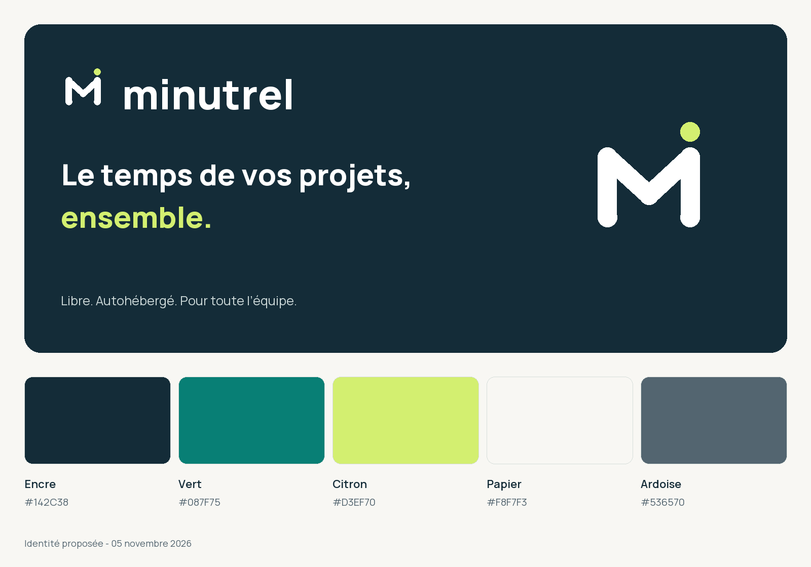

# Identité de marque de Minutrel

**Minutrel est le nom proposé pour remplacer le nom de travail Compte Temps.** Les résultats de recherche et leur portée figurent dans le [rapport de disponibilité](../docs/DISPONIBILITE_NOM.md). Aucun domaine ni marque n’a été réservé.



## Documents et aperçu

- [Charte graphique PDF](../output/pdf/minutrel-charte-graphique.pdf).
- [Identité de marque et règles d’usage](../docs/IDENTITE_DE_MARQUE.md).
- [Aperçu HTML local](preview/index.html), avec variantes et exemple d’interface.
- [Tokens JSON](tokens.json) et [variables CSS](tokens.css).

## Ressources livrées

| Dossier | Contenu |
| --- | --- |
| `assets/logos` | Logos vectorisés, versions principale, inversée, monochromes et symbole ; PNG transparents. |
| `assets/icons` | Favicon SVG, PNG de 16 à 1024 px, ICO Windows et ICNS macOS. |
| `assets/social-preview.png` | Image de partage de 1200 × 630 px. |
| `fonts` | Manrope variable et instances 400, 600, 800 ; licence SIL OFL incluse. |
| `preview` | Planche PNG et page de présentation de l’identité. |
| `manifest.json` | Empreintes SHA-256 des sources et ressources générées. |

Les icônes natives sont aussi copiées dans le projet Tauri. Les logos SVG sont autonomes, avec lettres transformées en tracés, et ne chargent aucune police distante.

## Reconstruire et vérifier

Avec Python 3.12 :

```sh
python3 -m venv .venv
.venv/bin/python -m pip install -r requirements-brand.txt
.venv/bin/python scripts/build_brand.py
python3 scripts/check_brand.py
```

Sous Windows, utiliser `.venv\Scripts\python.exe` à la place de `.venv/bin/python`. Le générateur reconstruit les ressources et la charte PDF. Une nouvelle version doit être rendue et inspectée visuellement avant livraison ; les empreintes ne valident pas la qualité de mise en page.

Les ressources originales suivent la licence AGPL du dépôt. La police conserve sa licence [OFL](fonts/OFL.txt). Aucune exclusivité de marque ni dépôt de marque n’est revendiqué par ces fichiers.
