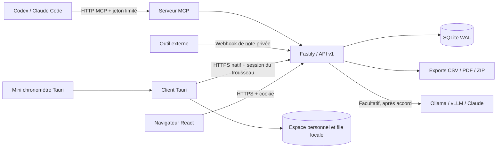

# Architecture de Minutrel V0.1

Les clients reliés à une équipe utilisent la même API et les mêmes comptes. **SQLite réside sur le serveur commun.** Le client ordinateur possède aussi un espace personnel autonome et une file durable séparée pour ses comptes d’équipe. Le stockage local passe par Rust, avec fichiers versionnés et copie de l’état précédent ; aucun serveur ou processus Node n’est embarqué.

## Choix techniques

- Node.js 24 et Fastify pour un processus serveur unique.
- SQLite intégré à Node, clés étrangères activées, WAL et transactions courtes. Pas de PostgreSQL, Redis, broker ou ORM requis pour cette version.
- React et TypeScript pour l’interface commune, Vite pour la construction.
- Tauri 2 et Rust pour les fonctions ordinateur. La WebView du système évite d’embarquer Chromium.
- Bibliothèque Temporal pour les bornes calendaires, PDFKit pour les PDF serveur, pdf-lib/fontkit chargés à la demande pour les PDF locaux et fflate pour les ZIP.
- SDK officiel MCP pour Streamable HTTP en mode sans session persistante de protocole.

Le serveur peut servir l’interface construite et l’API seul. L’image nginx reste disponible pour valider ou utiliser un proxy séparé. Le [Compose principal](../compose.yml) utilise une seule application et un volume de données.

## Chronomètre

Le serveur stocke les instants des segments ; il ne réécrit pas la base chaque seconde. Une pause ferme le segment ouvert et une reprise en crée un autre. Une contrainte unique interdit deux temps actifs pour le même membre. Le total est calculé en secondes entières ; un arrêt immédiat sans durée positive retire l’entrée vide.

Les écritures du chronomètre portent une clé d’idempotence et une version. Une répétition renvoie le résultat d’origine ; une clé réutilisée pour une autre demande ou une version obsolète produit un conflit. Les clients relisent ensuite l’état partagé.

Les clients utilisent SSE pour recevoir une invalidation, puis relisent les données auxquelles le compte a droit. Le client natif partage une connexion SSE entre ses fenêtres. Le widget charge les projets et le chronomètre, sans charger les rapports et les notes. Seul l’affichage du compteur actif se rafraîchit chaque seconde, sans trafic réseau associé.

Les commandes natives sont sauvegardées localement avant envoi. Le serveur reçoit un instantané contrôlé par version, revalide les segments et calcule les secondes. Les reçus durables évitent les doubles imports. Un conflit ne remplace pas une autre version : la proposition reste locale jusqu’à résolution. Les détails de l’[autonomie et de la synchronisation](SYNCHRONISATION.md) font partie du contrat V0.1.

## Sessions et droits

Le navigateur utilise un cookie HttpOnly SameSite=Strict et un jeton CSRF. HTTPS en production active le drapeau Secure. Le client Tauri réalise les requêtes dans Rust et garde la session dans le trousseau du système ; le jeton n’est pas conservé dans localStorage ni remis au rendu JavaScript.

Les mots de passe utilisent scrypt, avec un sel propre à chaque compte. Les sessions et les jetons MCP sont indexés par une empreinte SHA-256. Les secrets des fournisseurs IA sont chiffrés avec AES-256-GCM ; la clé serveur fait partie des éléments à sauvegarder. Une désactivation ou un changement de rôle révoque les accès concernés.

Les fichiers locaux sont protégés par le compte du système, sans chiffrement indépendant. Les espaces sont séparés par serveur et membre ; une réponse d’un compte précédent ne doit pas être appliquée au compte courant. L’espace autonome n’ouvre pas de port réseau.

## Rapports et traitements

Les bornes mensuelles sont calculées dans le fuseau de l’espace. Les intervalles traversant une frontière mensuelle sont découpés, avec prise en compte des changements d’heure. Les durées manuelles appartiennent à leur date déclarée.

Les agrégats sont calculés à partir des temps finalisés. Les pages reçoivent un aperçu borné ; les exports créent un instantané privé avant de générer CSV, PDF ou ZIP. PDF et IA disposent de files séparées, sérialisées. Une réponse IA est un brouillon de texte, sans chemin d’écriture sur les durées.

Le [modèle de données](MODELE_DE_DONNEES.md), le [contrat HTTP](API.md) et les [limites de la V0.1](ETAT_V0_1.md) précisent cette architecture.
