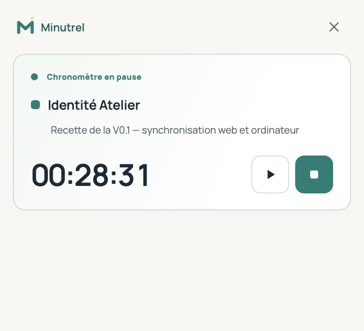
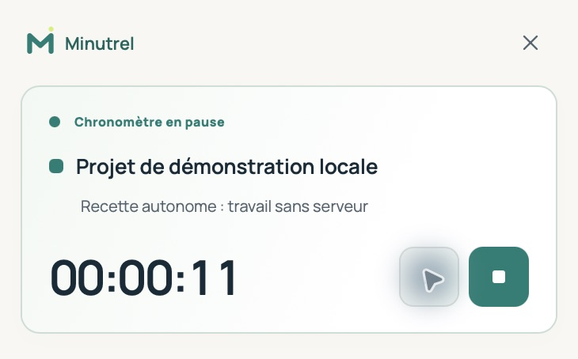

# Commande rapide du chronomètre

Guide vidéo en anglais : [le mini chrono](https://youtu.be/oTt_Pdyksdw). [Tous les guides et sous-titres](VIDEOS.md).

Le sélecteur choisit uniquement un **projet Minutrel autorisé**. Il ne parcourt pas les dossiers du disque et ne surveille aucun fichier.

## Ordinateur

Le bouton **Mini chrono**, le menu de l’icône de barre de menus/notification ou `Ctrl/Cmd + Alt + M` ouvre le widget. Il reste au-dessus des fenêtres ordinaires, peut être déplacé par sa barre supérieure et propose projet, tâche facultative, démarrage, pause, reprise et arrêt.

Sa hauteur suit son contenu. La fermeture du widget libère cette fenêtre ; l’icône permet de la recréer. Le bouton « Minutrel » ramène la fenêtre principale. Fermer la fenêtre principale la masque ; **Quitter** termine le client. Un chronomètre personnel reste dans le journal local ; un temps déjà reçu sur le serveur y continue jusqu’à son arrêt explicite.

Le client natif garde une session commune dans Rust et partage une connexion SSE entre ses fenêtres. Le compteur est local et ne produit pas de requête chaque seconde. Le widget ne charge pas l’historique et les rapports.

Le raccourci dépend de sa disponibilité dans le système. Les bureaux Linux/Wayland et les modes plein écran peuvent imposer leurs propres règles de placement ; les trois plateformes doivent faire l’objet d’une recette terrain.

Le widget fonctionne aussi sans serveur dans l’espace personnel. Les comptes reliés conservent leurs actions hors connexion dans la file locale, avec indication d’attente et de conflit.

## Navigateur

La navigation conserve une barre compacte dès qu’un chronomètre est actif. Le bouton **Mini chrono** est proposé si Document Picture-in-Picture existe ; le navigateur peut ouvrir une fenêtre compacte au-dessus des fenêtres ordinaires. Si cette API est absente, la barre intégrée reste disponible. Fermer la page ne met pas fin à un temps côté serveur.

## États

Les textes distinguent absence de temps, travail, pause, stockage personnel, attente d’envoi, coupure et conflit. Le serveur conserve l’unicité du temps actif d’un membre. Plusieurs appareils déconnectés peuvent produire des propositions incompatibles ; la synchronisation les refuse sans écraser l’historique. Voir [la gestion des conflits](SYNCHRONISATION.md).
