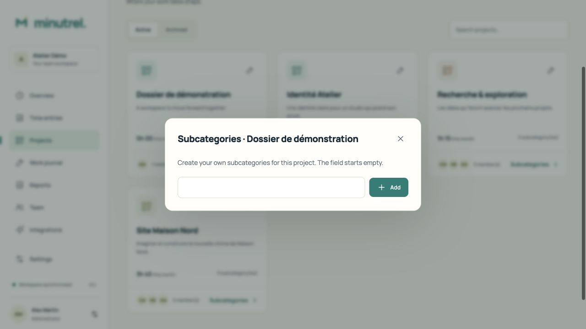
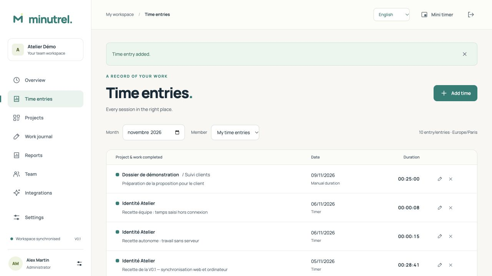

# Custom project subcategories

[English user guide](guide/en/README.md) · [Français](guide/fr/README.md) · [Deutsch](guide/de/README.md)

A Minutrel project acts as the main folder for work. Each project can contain one optional level of **subcategories**, with names chosen entirely by its users. There are no predefined labels and no automatic “Marketing” or “Finance” categories. New projects start with an empty list, and the creation input starts blank without a placeholder.

## Create your own names

1. Open **Projects**, then **Subcategories** on the relevant project.
2. Type the name you want in the empty **Subcategory name** field and choose **Add**. Names are trimmed and must contain 1–200 characters.
3. Repeat for any other subcategories needed by this project. Labels belong to their project; they are not a global catalogue.

Managers and administrators manage team subcategories. Contributors choose from their assigned projects’ active subcategories when recording time. Standalone desktop users manage their own. Team category management needs the server; a previously loaded category can be used for offline desktop time recording.

## Describe the work you did

Choose a project and optional subcategory in the main timer or manual-entry form. Enter your own **work description**, then record the time. For example, a user may create a category named “Client follow-up” and describe an entry as “Prepared the proposal and reviewed the client’s feedback”. This is an example only; neither field is prefilled.

The mini timer also offers the subcategory selector. To add or refine a description after recording from the widget, open **Time entries**, use the edit button, select **Description** and enter a reason. This preserves the recorded seconds.

Subcategories are optional: choose **No subcategory** to record directly against a project. Changing the selected project clears the subcategory selection. Archiving hides a category from new entries while preserving its historical names and descriptions. An active timer must be stopped before its category can be archived.

## Reports, sync and compatibility

- Team clients share the same project subcategories and permissions through their server. Offline timer/manual-entry sync retains `taskId` and the work description and rechecks project access on receipt.
- Time history and report entries include the project, selected subcategory and work description. Server CSV/PDF and standalone CSV/PDF/ZIP exports retain this information.
- Local CSV adds a `subcategory` column at the end, keeping previous column positions. Server CSV uses the translated Subcategory header; integrations that match headers must account for the label change.
- The API and database keep the existing `tasks`, `taskId` and `taskName` names for compatibility. Existing tasks appear as subcategories; no data migration is required. Categories are not a second independent hierarchy alongside tasks.
- Personal-work transfer maps projects explicitly; it does not automatically recreate personal subcategories in a team. Original personal entries remain local. Select or create the required team categories and use the existing correction flow if you need to classify transferred entries.

This version supports a single subcategory level inside each project, not recursive nesting or local disk folders. General work notes remain associated with a project; descriptions on time entries carry the per-subcategory account of completed work.
