# Minutrel V0.1 — Benutzerhandbuch

Englische Videos mit Sprecherstimme, Musik und Untertiteln: [Einführung](https://youtu.be/q6VeUbyOhn8), [erste Schritte](https://youtu.be/u5MItUvsxQc) und [alle 12 Videoanleitungen](../../VIDEOS.en.md).

[Français](../fr/README.md) · [English](../en/README.md) · [Deutsch](README.md)

Dieses Handbuch beschreibt die gelieferten Funktionen der Version 0.1.0. Die Abbildungen zeigen fiktive Daten. Einige Detailaufnahmen stammen aus der französischen Oberfläche; Aufbau und Aktionen sind in allen Sprachen gleich. Projektnamen, Beschreibungen und Notizen bleiben in ihrer ursprünglichen Sprache.

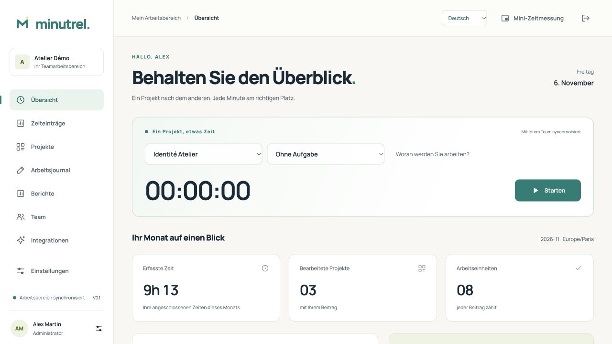

## 1. Nutzungsart wählen

| Modus | Konto und Daten | Verbindung |
| --- | --- | --- |
| Eigenständige Desktopanwendung | Ein persönlicher Arbeitsbereich auf diesem Computer, ohne Onlinekonto | Kein Server für Projekte, Zeitmessung, manuelle Einträge, Notizen, manuelle Arbeitsberichte und lokale Exporte nötig |
| Mit einem Team verbundene Desktopanwendung | Ihr Konto auf dem Teamserver, mit persönlicher lokaler Kopie | Einmal online anmelden; danach Zeitmessung und neue Zeiteinträge auch offline erfassen |
| Webbrowser | Ihr Konto und die Daten auf dem Teamserver | Serververbindung erforderlich; der Browser bietet keinen eigenständigen lokalen Arbeitsbereich |

Wählen Sie immer ein **Minutrel-Projekt**, keinen Ordner des Computers. KI ist optional; es wird kein Modell mitgeliefert.

## 2. Ohne Server beginnen

Installieren Sie das Paket für Ihr Betriebssystem. V0.1-Pakete sind nicht signierte Testpakete. Wählen Sie auf der Anmeldeseite **Auf diesem Computer verwenden**. Wenn Sie bereits mit einem Team verbunden sind, öffnen Sie **Einstellungen → Persönlichen Arbeitsbereich öffnen**.

Erstellen Sie unter **Projekte → Neues Projekt** Ihr erstes Projekt. Der persönliche Arbeitsbereich besitzt ein Profil und wird durch Ihr Betriebssystemkonto geschützt. E-Mail-Adresse, Passwort und Onlinedienst sind nicht erforderlich. Name und Zeitzone werden in den Einstellungen geändert; nach dem ersten Zeiteintrag bleibt die Zeitzone unverändert.

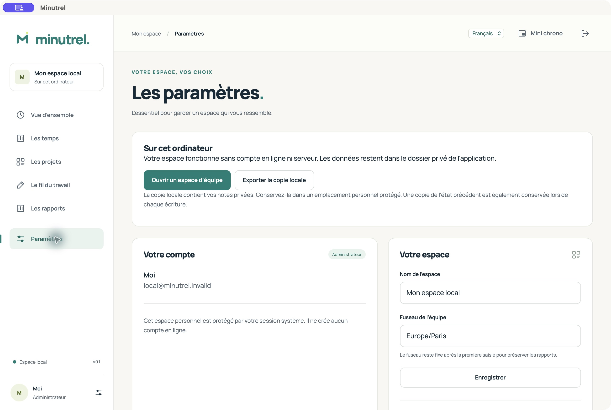

Die Daten werden im privaten Anwendungsordner gespeichert; der vorherige Stand bleibt als Kopie erhalten. Nutzen Sie regelmäßig **Lokale Kopie exportieren** und sichern Sie den gesamten Konfigurationsordner. Die JSON-Kopie enthält auch private Notizen. Beim Öffnen des persönlichen Arbeitsbereichs werden keine Daten an ein Team gesendet.

## 3. Einem Team beitreten und Rollen verstehen

Der Administrator teilt Ihnen die HTTPS-Adresse des Servers und Ihr Konto mit. Öffnen Sie diese Adresse im Browser. Wählen Sie am Computer **Teamarbeitsbereich öffnen**, tragen Sie dieselbe Adresse ein und übernehmen Sie sie über den Pfeil neben dem Eingabefeld. Melden Sie sich anschließend mit demselben Konto an. HTTP ist nur für einen Server auf diesem Computer zulässig.

| Rolle | Rechte in V0.1 |
| --- | --- |
| Mitarbeiter | Eigene Zeiten, Notizen und persönliche Berichte; zugewiesene Projekte |
| Verantwortlicher | Alle Projekte und Teamzeiten, einschließlich begründeter Korrekturen |
| Administrator | Zusätzlich Konten, Integrationen, gemeinsame Monatsexporte und Verwaltungsprotokoll |

Unter **Team → Mitglied hinzufügen** erstellt ein Administrator Konten mit einem Erstpasswort aus mindestens zwölf Zeichen. Übermitteln Sie es privat. Das Mitglied kann es in den Einstellungen ändern. **Bearbeiten** ändert Rolle oder Aktivierung. Eine Deaktivierung widerruft Zugriffe und bewahrt die Historie. Der letzte aktive Administrator kann nicht entfernt werden. Beenden Sie vor der Deaktivierung eine noch aktive Zeitmessung; das Zeitsymbol erlaubt einen protokollierten Administratoreingriff mit Begründung.

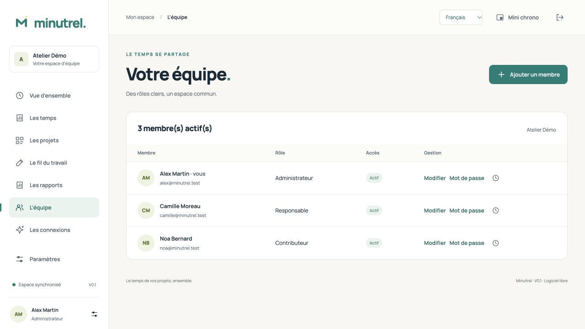

E-Mail-Einladungen, SSO und auf einzelne Projekte begrenzte Verwaltungsrollen gehören noch nicht zu V0.1. Verantwortliche verwalten das gesamte Team.

## 4. Projekte, Unterkategorien und Archivierung

Die Namen bestimmen Sie selbst. **Unterkategorien** öffnet ein leeres Eingabefeld ohne vordefinierte Namen oder Platzhalter. Geben Sie Ihren eigenen Namen ein und wählen Sie **Hinzufügen**. Neue Projekte enthalten keine Unterkategorie. Wählen Sie anschließend Projekt und optionale Unterkategorie und beschreiben Sie die erledigte Arbeit. Ältere Aufnahmen können diese Ebene noch „Aufgaben“ nennen.

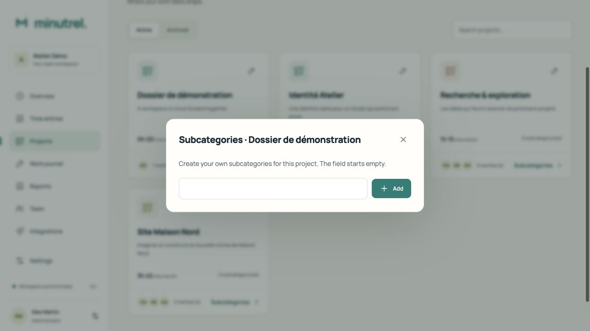

Unter **Projekte** können Sie suchen und zwischen aktiven und archivierten Projekten wechseln. Verantwortliche und Administratoren bearbeiten Name, Beschreibung, Farbe und zugewiesene Mitglieder. **Unterkategorien** erstellt oder archiviert optionale Unterkategorien. Mitarbeiter sehen ihre zugewiesenen Projekte. Im persönlichen Arbeitsbereich verwalten Sie Ihre eigenen Projekte.

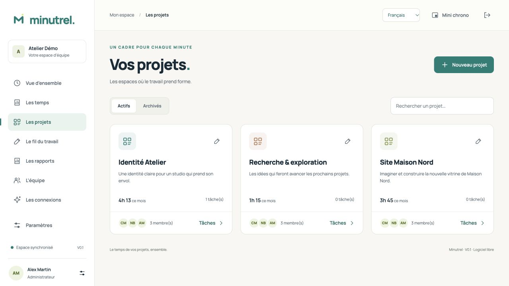

Vor der Archivierung müssen aktive Zeitmessungen des Projekts beendet werden. Die bisherigen Zeiteinträge bleiben erhalten.

## 5. Zeit erfassen und Mini-Zeitmessung verwenden

Wählen Sie in der **Übersicht** ein Projekt, bei Bedarf eine Unterkategorie, beschreiben Sie Ihre Arbeit und klicken Sie auf **Starten**. **Pause** unterbricht die Zählung, **Fortsetzen** führt denselben Eintrag weiter. **Beenden** schließt ihn ab. Pausen werden nicht gezählt.

**Mini-Zeitmessung** öffnet ein verschiebbares Fenster über gewöhnlichen Fenstern. Am Computer gibt es zusätzlich ein Symbol in der Menüleiste/im Infobereich und, soweit verfügbar, `Strg/Cmd + Alt + M`. Das Widget passt seine Höhe an den Inhalt an. **Minutrel** öffnet das Hauptfenster; das Kreuz blendet das Widget aus. Vollbildprogramme und manche Linux-/Wayland-Umgebungen bestimmen die Fensterplatzierung selbst.

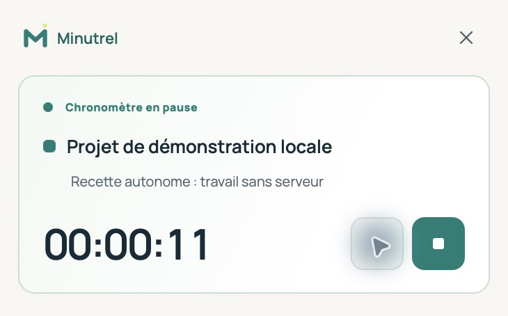

Das Schließen eines Fensters oder Beenden der Anwendung stoppt keine Zeitmessung. Persönliche Zeiten bleiben im lokalen Journal; bereits angenommene Teamzeiten laufen auch auf dem Server weiter. Der Ruhezustand des Computers ist keine automatische Pause. Beenden Sie die Messung ausdrücklich, wenn die Arbeit endet.

Im Browser bleibt beim Navigieren eine kompakte Leiste erreichbar. Ein separates Minifenster benötigt Document Picture-in-Picture; andernfalls verwenden Sie die Leiste.

## 6. Offline arbeiten und synchronisieren

| Anzeige | Bedeutung |
| --- | --- |
| Lokaler Arbeitsbereich | Persönliche Daten werden nur auf diesem Computer gespeichert |
| Arbeitsbereich synchronisiert | Server erreichbar, keine lokalen Änderungen warten auf Annahme |
| Übertragung ausstehend | Zeiteinträge lokal gespeichert, noch nicht vom Server angenommen |
| Offline | Zeitmessung und neue manuelle Einträge bleiben am Computer möglich; Teamverwaltung benötigt den Server |
| Konflikt zu lösen | Server lehnt Version, Zuweisung oder Überschneidung ab; lokale Vorschläge bleiben erhalten |

Die erste Onlineanmeldung bereitet Konto, Projekte und laufende Zeitmessung vor. Öffnen Sie nach dem Update eines älteren Clients Ihr Teamkonto einmal online, um den lokalen Cache mit der Sitzung zu verknüpfen. Die Warteschlange bleibt nach dem Schließen erhalten. Sobald der Server erreichbar ist, werden die Übertragungen fortgesetzt; **Einstellungen → Synchronisieren** versucht es erneut. Eine abgelaufene Sitzung kann eine erneute Anmeldung mit demselben Konto verlangen. Löschen Sie keine Anwendungsdaten, solange Einträge ausstehen. Nach 30 Tagen ohne Kontoprüfung erfordert das Öffnen einer Teamkopie eine Verbindung; der persönliche Arbeitsbereich hat diese Frist nicht.

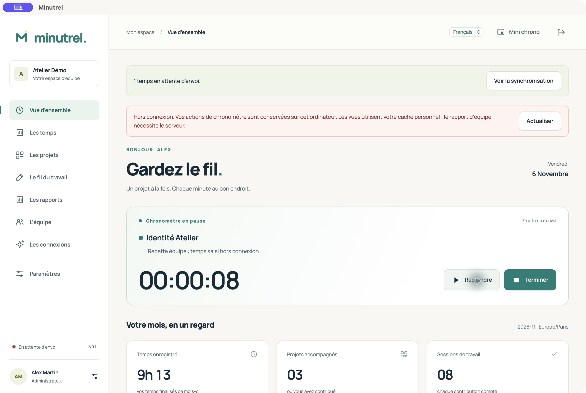

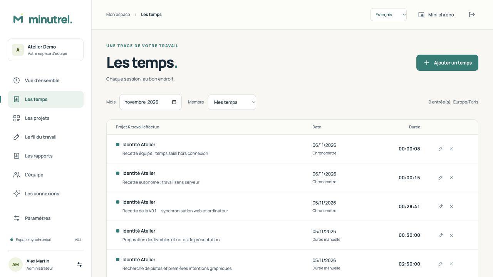

Erfassen Sie dasselbe Zeitintervall möglichst nicht auf mehreren getrennten Geräten. Der Server prüft Berechtigungen, Überschneidungen und die aktive Zeitmessung erneut. Ein anderes Geräteprotokoll wird nicht stillschweigend überschrieben.

Bei einem Konflikt beenden Sie die lokale Zeitmessung, exportieren eine Kopie und vergleichen den Serverstand. **Warteschlange archivieren und Serverstand behalten** bewahrt die Vorschläge in lokalen Archiven und lädt den Serverstand. Tatsächlich fehlende Zeiten können Sie nach Prüfung manuell nachtragen. V0.1 führt abweichende Verläufe nicht automatisch zusammen. Projektverwaltung, Korrekturen von Servereinträgen, gemeinsame Berichte und KI-Konfiguration benötigen eine Verbindung. Eine lokale Vorschau ersetzt keinen vollständigen Teambericht.

## 7. Persönliche Arbeit in ein Team übertragen

Beenden Sie persönliche Zeitmessungen, öffnen Sie Ihr Teamkonto und wählen Sie **Einstellungen → Meine lokale Arbeit übertragen → Meinen lokalen Arbeitsbereich lesen**. Ordnen Sie jedem ausgewählten persönlichen Projekt ein vorhandenes, erlaubtes Teamprojekt zu. Projekte ohne Zuordnung bleiben lokal.

Abgeschlossene Einträge werden in Ihr Teamkonto kopiert; die Originale bleiben auf dem Computer. Unterkategorien werden nicht neu erstellt und private Notizen nicht übertragen. Erneute Versuche erkennen bereits empfangene Zeiten. Behalten Sie die Zuordnung nach dem ersten Senden bei; Änderungen werden als Konflikt behandelt. Die Arbeitsbereiche werden nicht automatisch verschmolzen. Es handelt sich auch nicht um die Synchronisierung zweier Teams.

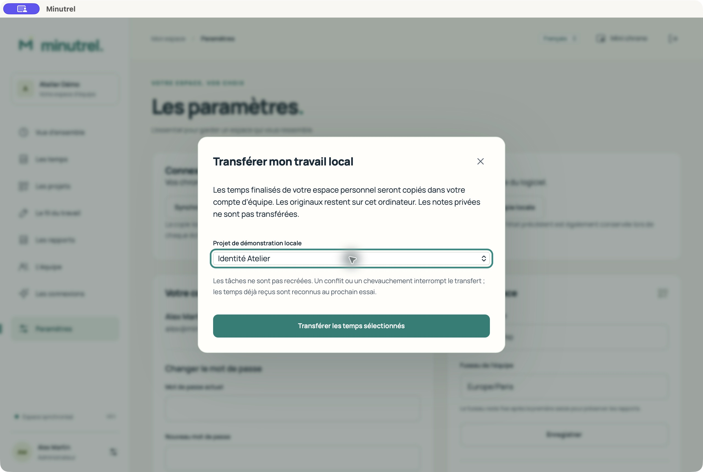

## 8. Zeiten manuell erfassen und korrigieren

Unter **Zeiteinträge** wählen Sie den Monat. Verantwortliche und Administratoren können andere Teammitglieder auswählen. Listen sind seitenweise aufgebaut; breite Tabellen lassen sich auf kleinen Bildschirmen seitlich verschieben.

**Zeit hinzufügen → Dauer** akzeptiert beispielsweise `1h30`, `90 min` oder `1,5 h` für heute oder ein vergangenes Datum, bis zu 24 Stunden je Eintrag. **Beginn und Ende** verlangt ein vollständig vergangenes Intervall von höchstens sieben Tagen mit ausdrücklichem UTC-Zeitversatz, etwa `+01:00` oder `+02:00` in Paris je nach Jahreszeit. Bestätigen Sie nur beabsichtigte Überschneidungen; der Server prüft sie beim Synchronisieren erneut.

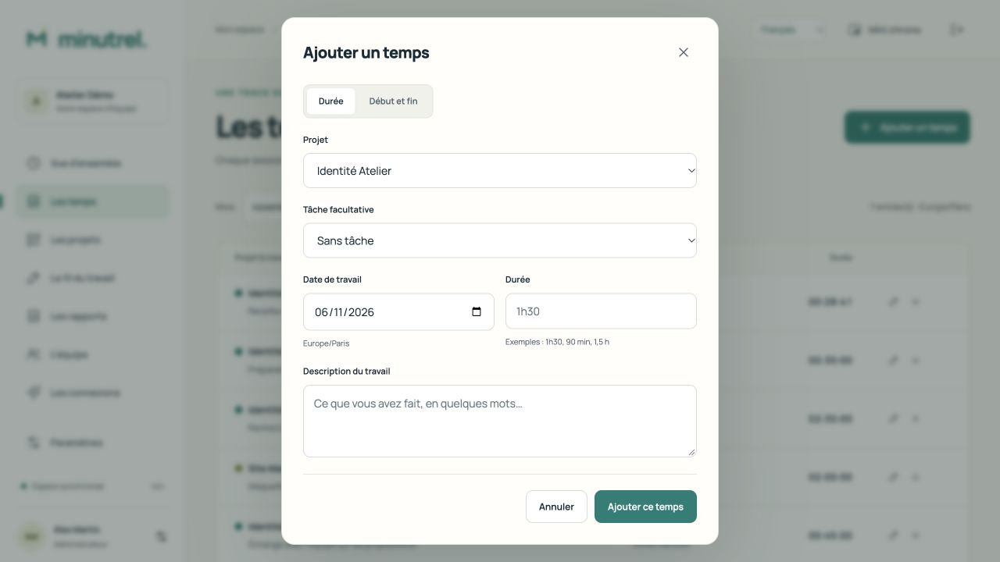

Der Stift korrigiert einen abgeschlossenen Eintrag mit Begründung. **Beschreibung** bewahrt ursprüngliche Abschnitte und Sekunden. **Dauer** oder **Beginn und Ende** ersetzt Abschnitte; alter Wert und Grund werden protokolliert. Das Kreuz entfernt einen Eintrag mit Begründung aus Berichten. Bei einer veralteten Version zuerst aktualisieren. Teamkorrekturen benötigen eine Verbindung. Das lokale Korrekturprotokoll bewahrt bis zu 1.000 der letzten Korrekturen.

## 9. Notizen, Arbeitsberichte und KI

Unter **Arbeitsjournal → Notiz hinzufügen** wählen Sie Projekt, Datum und Text. Private Notizen sehen nur Sie und ausdrücklich dazu berechtigte Assistenten. **Prüfen / teilen** steuert die Aufnahme in Teamberichte. Das Löschen einer Notiz ist endgültig und muss in der Anwendung bestätigt werden.

**Verfassen** erstellt einen manuellen Monatsbericht. Unter **Prüfen und freigeben** bearbeiten und bestätigen Sie den Text für Berichte. Entwürfe bleiben privat.

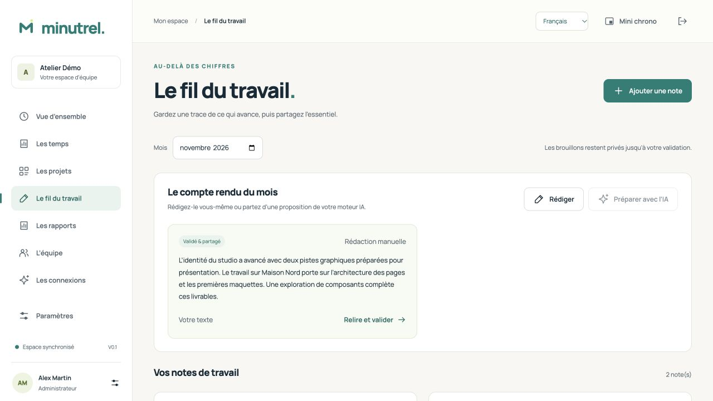

Ein Administrator kann unter **Integrationen** Ollama, vLLM oder Claude konfigurieren. Prüfen Sie unter **Mit KI vorbereiten** die angezeigte Adresse, bevor Sie der Übermittlung Ihrer Beschreibungen und Notizen einschließlich privater Notizen zustimmen. Wenn sich die Anbietereinstellungen ändern, öffnen Sie das Formular erneut und bestätigen Sie den Empfänger. Prüfen Sie den privaten Entwurf vor der Freigabe. KI ändert keine berechneten Zeitsummen. Im eigenständigen Modus können Sie Notizen und Arbeitsberichte manuell verfassen.

## 10. Monatsberichte und Exporte

Wählen Sie unter **Berichte** den Monat. Teamadministratoren wählen unter **Gesamtes Team** die Beschäftigten aus, auch deaktivierte Mitglieder für historische Daten, und laden **CSV**, **PDF** oder **ZIP-Archiv** herunter. Andere Rollen sehen ihren persönlichen Bericht. Eigenständige Exporte enthalten Ihre lokale Arbeit.

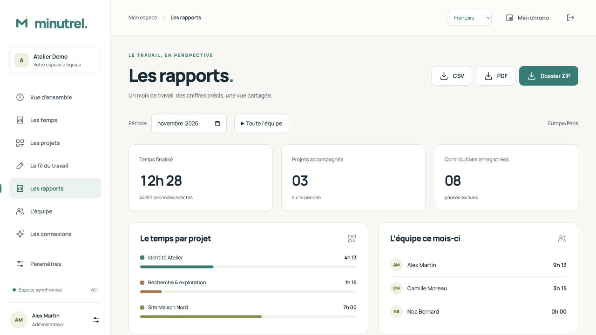

Summen verwenden exakte abgeschlossene Sekunden, ohne Pausen, gelöschte Einträge oder aktive Zeitmessungen. Monatsübergreifende Intervalle werden in der Zeitzone des Arbeitsbereichs aufgeteilt, auch beim Wechsel der Sommerzeit. Private Notizen und nicht freigegebene Arbeitsberichte sind ausgeschlossen.

CSV verwendet UTF-8 und Semikolon. Serverberichte folgen der gewählten Sprache; persönliche CSV-Spalten bleiben für andere Werkzeuge stabil. Das PDF enthält Seitenzahlen. Team-ZIP enthält Zeiten-CSV, Projektsummen, gemeinsamen Bericht und einzelne PDFs. Persönliches ZIP enthält CSV, PDF und Berichts-JSON.

Serverexporte sind private Momentaufnahmen, die dem erstellenden Administrator 24 Stunden zum Herunterladen zur Verfügung stehen. Spätere Korrekturen ändern die Momentaufnahme nicht. Grenzen: 100 Mitglieder und 20.000 Einträge pro Teamexport; die Bildschirmvorschau zeigt 100 Einträge mit vollständigen Summen. Für einen abschließenden Teambericht zunächst ausstehende Zeiten synchronisieren und aktive Messungen beenden.

## 11. Codex, Claude Code, API und Webhook

Unter **Integrationen → Zugriff erstellen** wählen Sie Name, Ablauf und die nötigen Rechte. Kopieren Sie den Schlüssel einmal. **Assistenten einrichten** zeigt Konfigurationen für Codex und Claude Code. Speichern Sie den Token in `MINUTREL_MCP_TOKEN`, außerhalb des Quellcode-Repositorys. **Widerrufen** beendet den Zugriff.

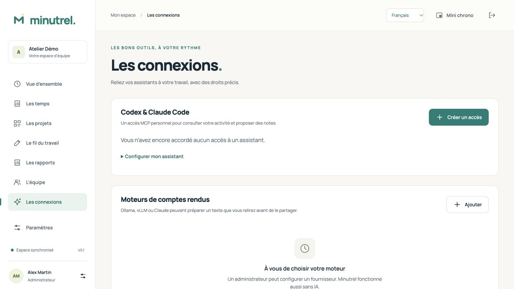

Die Steuerung der Zeitmessung benötigt ein zusätzliches, standardmäßig nicht aktiviertes Recht. Auch Tokens von Administratoren bleiben persönlich. Assistentennotizen beginnen als private Entwürfe. REST verwendet Anwendungssitzungen; MCP-Tokens öffnen weder die allgemeine REST-API noch Teamexporte.

Automatisierungen können **`POST /hooks/work-notes`** mit `work.draft_own`, einem eindeutigen `Idempotency-Key` sowie `projectId`, `workDate` und `text` aufrufen. Das Ergebnis ist eine private Notiz zur Prüfung, keine Zeit oder automatisch geteilte Notiz. Wiederholungsschlüssel werden 30 Tage aufbewahrt. Der [API-/Webhook-Vertrag](../../API_WEBHOOKS.md) enthält HTTP-Beispiel und Fehlercodes. Ausgehende Webhook-Abonnements sind in V0.1 nicht enthalten.

## 12. Sprachen, Einstellungen und kleine Bildschirme

Wählen Sie **Français / English / Deutsch** bei der Anmeldung oder in der Kopfzeile. Der Sprachwechsel lädt die Oberfläche neu; speichern Sie Formulare vorher. Datumsanzeigen und Beschriftungen wechseln, Benutzereingaben und genaue Dauern bleiben unverändert. Betriebssystemeigene Steuerelemente können der Systemsprache folgen.

Auf kleinen Bildschirmen wird die Navigation zu einer horizontalen Leiste, Tabellen sind seitlich verschiebbar. Sprunglink, beschriftete Schaltflächen und reduzierte Animationen unterstützen die Tastaturnutzung. Responsive-Prüfungen ersetzen keine vollständige Barrierefreiheitsprüfung. [Mobile Aufnahme ansehen](../../screenshots/10-mobile-de.jpg).

Unter **Einstellungen** finden Sie Passwort, Serveradresse und als Administrator Arbeitsbereichskonfiguration, JSON-Export geteilter Arbeit und Verwaltungsprotokoll. Passwortänderungen widerrufen vorherige Zugriffe. Ein JSON-Export ersetzt keine vollständige Serversicherung.

## 13. Sichern und Fehler beheben

Für Server gelten [Sicherung/Wiederherstellung](../../../infra/backup/README.md) und [Selbsthosting](../../AUTOHEBERGEMENT.md). Sichern Sie Datenbank und Schlüssel zusammen. Für den eigenständigen Client beenden Sie die Anwendung und kopieren den gesamten Konfigurationsordner einschließlich `offline-*.json`, `.bak` und `connection.json`. Übliche Pfade: `~/Library/Application Support/app.minutrel.desktop` unter macOS, `%APPDATA%\app.minutrel.desktop` unter Windows und `$XDG_CONFIG_HOME/app.minutrel.desktop` oder `~/.config/app.minutrel.desktop` unter Linux. Eine JSON-Kopie lässt sich zusätzlich in den Einstellungen exportieren; die Wiederherstellung über die Oberfläche ist noch nicht enthalten.

Nach der Wiederherstellung des Teamservers melden sich die Mitglieder erneut an. Erstellen Sie für die verwendeten Integrationen neue MCP- oder Webhook-Tokens.

| Problem | Prüfung |
| --- | --- |
| Keine Projekte | Zuweisung erfragen oder persönliches Projekt erstellen |
| Server nicht erreichbar | URL, HTTPS, Zertifikat und Netzwerk prüfen; KI ist für Zeiten nicht nötig |
| Zeit fehlt im Bericht | Zeitmessung beenden; Monat, Zeitzone, Mitglied und Warteschlange prüfen |
| Konflikt oder entzogene Rechte | Lokale Dateien behalten, Kopie exportieren und Administrator kontaktieren |
| Widget fehlt | Hauptfenster, Menüsymbol oder Mini-Zeitmessung verwenden; Vollbild- und Tastenkürzelregeln prüfen |
| KI nicht verfügbar | Anbieter und erlaubte Hosts prüfen; Bericht vorläufig selbst verfassen |

Melden Sie Fehler mit Version, Betriebssystem, lokalem/Teammodus, Schritten und Meldung. Entfernen Sie Passwörter, Tokens, private Notizen und Teamdaten aus Aufnahmen. Schwachstellen über den [Sicherheitskanal](../../../SECURITY.md) melden, ohne Ausnutzungsdetails öffentlich zu posten.

[Gelieferter Umfang](../../ETAT_V0_1.md) · [Dokumentierte Prüfungen](../../VALIDATION_CI.md) · [GitHub-Veröffentlichung](../../GITHUB.md). Weiterführende technische Dokumente werden derzeit auf Französisch gepflegt.

## 14. Projektplanung und Stundenzettel

Diese Funktionen sind in der Entwicklungsversion verfügbar. Die englischen Bildschirmfotos zeigen Beispieldaten.

### Projektübersicht und Aufgaben

1. Klicken Sie unter **Projekte** auf den Projektnamen. Unter **Projekt bearbeiten** können Sie ein optionales Zeitbudget wie `40 h` und eine Frist eintragen.
2. In der **Projektübersicht** sehen Sie die erfasste Zeit und das verbleibende Budget. Filtern Sie Arbeitsbeschreibungen und Summen nach Monat und Unterkategorie. Verantwortliche und Administratoren können auch ein Teammitglied auswählen. Mitarbeitende sehen ihre eigenen Zeiten.
3. Geben Sie unter **Aktionen → Neue Aufgabe** einen eigenen Titel ein. Ergänzen Sie bei Bedarf eine Unterkategorie, eine zuständige Person, geplante Termine und den geschätzten Aufwand. Verantwortliche und Administratoren können die Aufgabe bearbeiten. Zugewiesene Mitarbeitende können ihren Status ändern.
4. Wählen Sie in der Hauptzeitmessung oder bei der manuellen Eingabe das Projekt und die passende Unterkategorie und dann optional die Aufgabe. Erfassen Sie unter **Arbeitsbeschreibung**, was Sie erledigt haben. Die Aufgabe erscheint beim Zeiteintrag und in Exporten.

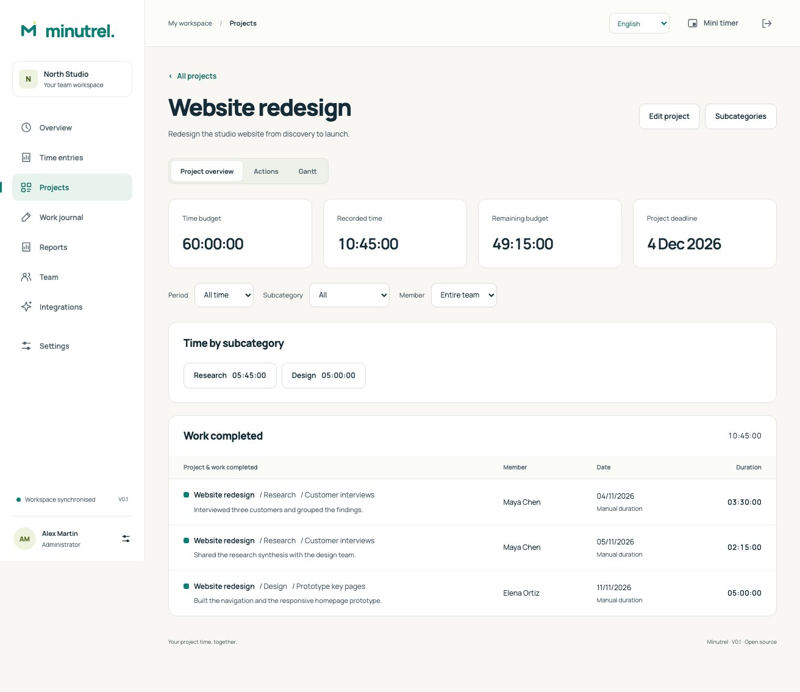

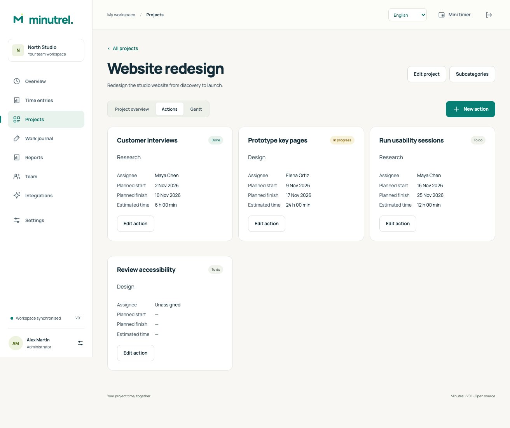

### Gantt und Auslastungsplanung

Öffnen Sie **Gantt** im Projekt. Unter **Zeitraum** können Sie 6 Wochen, 3, 6 oder 12 Monate, 3 oder 5 Jahre oder **Benutzerdefinierte Daten** wählen. Für eigene Zeiträume legen Sie den ersten und letzten Tag fest. Mit den Pfeilen springen Sie um einen ganzen Zeitraum. Eine Aufgabe mit einem Termin erscheint an diesem Tag. Aufgaben ohne Termine stehen unter dem Diagramm.

Unter **Projekte → Auslastungsplanung** sehen Sie den geschätzten Aufwand offener Aufgaben pro Person in denselben Zeiträumen. Die Schätzungen verteilen sich auf die geplanten Tage von Montag bis Freitag. Eine Aufgabe, die nur am Wochenende geplant ist, zählt zu diesem Wochenende. Geben Sie eine Wochenkapazität ein, um Überschreitungen hervorzuheben. Die Kapazität richtet sich nach den Arbeitstagen in der jeweiligen Spalte. Aufgaben ohne Termin oder Schätzung stehen unter **Zu planende Aufgaben**.

Administratoren können im **Team** den **Stundensatz** eines Mitglieds mit Betrag und Währung hinterlegen. Die Auslastungsplanung multipliziert die geplanten Stunden mit dem Stundensatz und zeigt den geschätzten Betrag in der Währung der jeweiligen Person. Stundensätze und Beträge im Team sind für Administratoren sichtbar. Im eigenständigen Arbeitsbereich lässt sich der persönliche Stundensatz unter **Einstellungen → Ihr Konto** festlegen. Zum Entfernen des Satzes lassen Sie den Betrag leer und speichern.

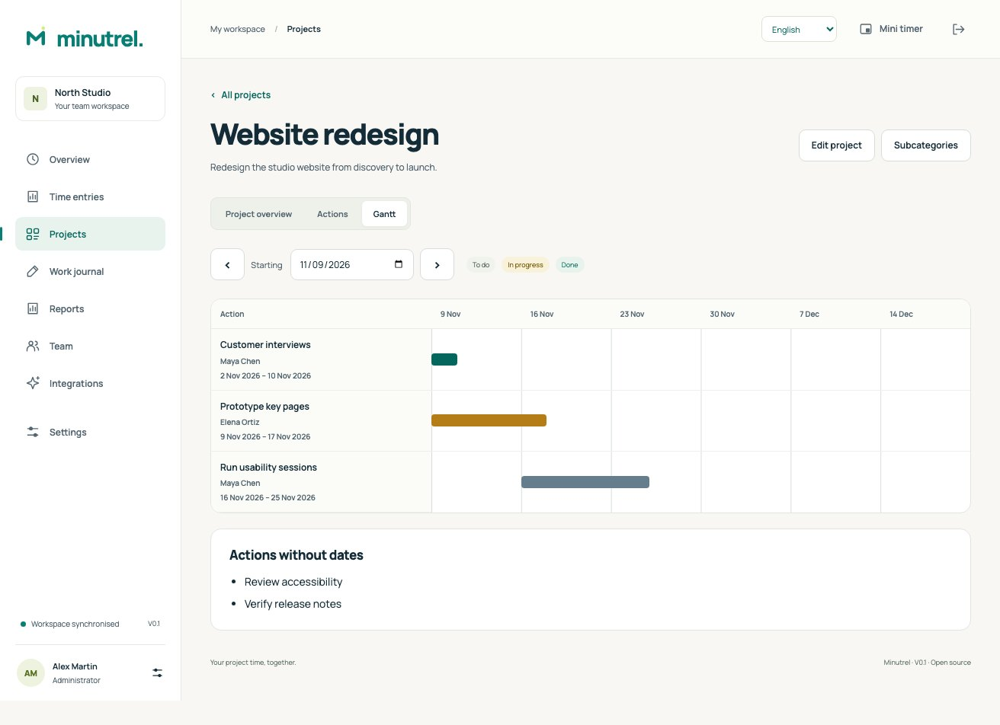

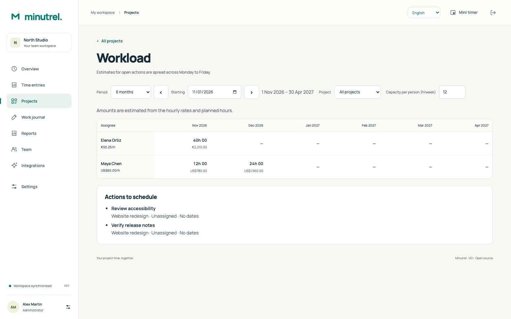

### Wöchentliche Freigabe und Monatsexporte

1. Öffnen Sie im Teamarbeitsbereich **Zeiteinträge → Stundenzettel** und wählen Sie eine Woche. Beenden Sie die laufenden Zeitmessungen dieser Woche und synchronisieren Sie ausstehende Desktop-Einträge. **Stundenzettel einreichen** sperrt die Zeiten der Woche bis zur Wiederöffnung.
2. Verantwortliche und Administratoren wählen ein Mitglied aus und prüfen die Zeiten. **Stundenzettel freigeben** bestätigt die Stunden. **Zur Korrektur zurückgeben** erfordert einen Grund und öffnet eingereichte oder freigegebene Stundenzettel wieder. Das Mitglied kann die Zeiten bearbeiten und erneut einreichen.
3. Administratoren wählen unter **Berichte** den Monat und bei Bedarf die Mitglieder. Aktivieren Sie **Nur freigegebene Zeiten** und laden Sie CSV, PDF oder ZIP herunter. Bei einem Zeiteintrag über eine Wochen- oder Monatsgrenze zählen die freigegebenen Sekunden im gewählten Monat. Der vollständige Bericht enthält auch geteilte Notizen und freigegebene Arbeitsberichte.

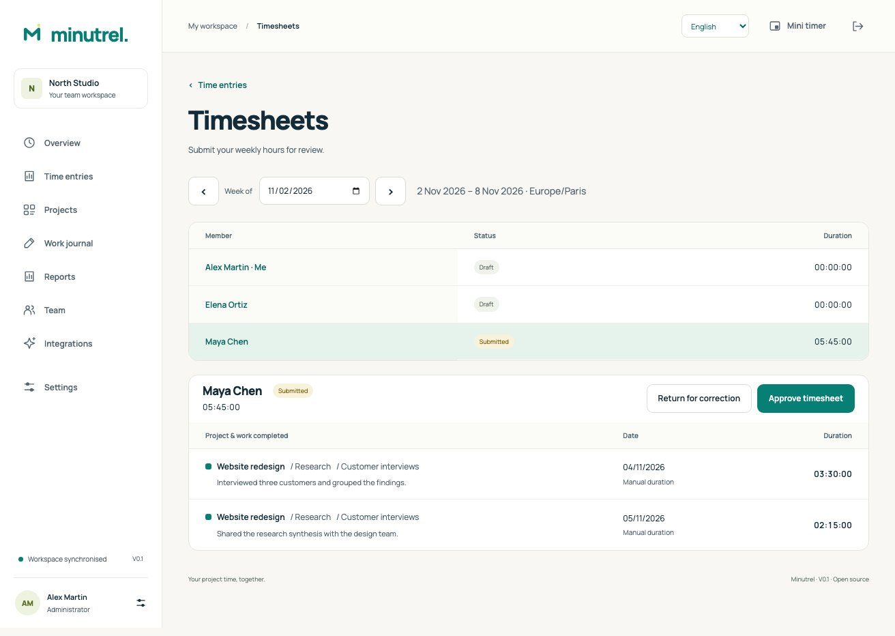

Der eigenständige Desktop-Client unterstützt die Projektplanung und die Zuordnung von Zeiten zu Aufgaben offline. Im verbundenen Client können bereits geladene Aufgaben auch offline ausgewählt werden. Änderungen an der Teamplanung sowie Einreichen und Freigeben von Stundenzetteln benötigen den Teamserver.
