# Minutrel V0.1 — User guide

English videos with narration, music and subtitles: [introduction](https://youtu.be/q6VeUbyOhn8), [getting started](https://youtu.be/u5MItUvsxQc) and [all 12 video guides](../../VIDEOS.en.md).

[Français](../fr/README.md) · [English](README.md) · [Deutsch](../de/README.md)

This guide covers the features delivered in version 0.1.0. Screenshots contain fictional data. Some detailed screenshots show the French interface; the layout and actions are shared across languages. Project names, descriptions and notes keep their original language.

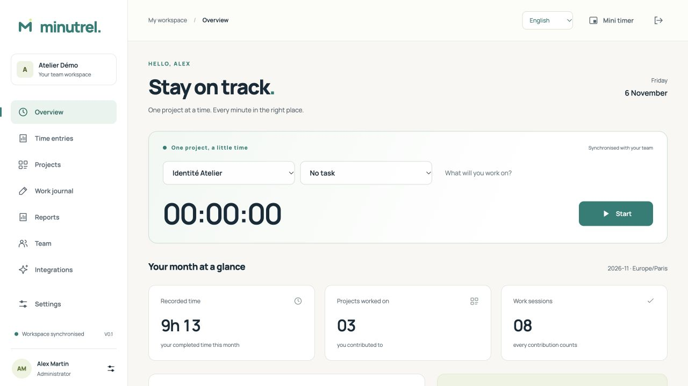

## 1. Choose how to use Minutrel

| Mode | Data and account | Connection |
| --- | --- | --- |
| Standalone desktop | One personal workspace on this computer; no online account | No server required for projects, time tracking, manual entries, notes, manual summaries or local exports |
| Desktop connected to a team | Your account on the team server, with a personal local copy | Connect online once; then record timer actions and new time entries offline |
| Web browser | Your account and data on the team server | Server connection required; the browser does not provide a standalone workspace |

Always choose a **Minutrel project**, never a folder on your computer. AI is optional and no model is bundled.

## 2. Start without a server

Install the package for your operating system. V0.1 packages are unsigned test packages. On the sign-in screen choose **Use on this computer**. If already connected to a team, open **Settings → Open my personal workspace**.

Create your first project in **Projects → New project**. Your personal workspace has one profile, protected by your operating system account. It needs no email address, password or online service. Change the workspace name and time zone in **Settings** before recording time; the time zone is fixed after the first entry.

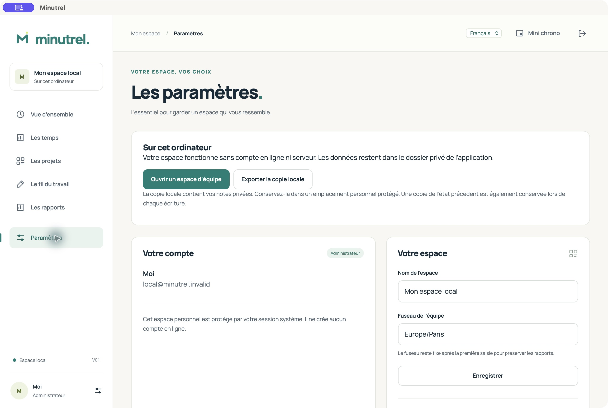

Data is written to the app’s private folder with a previous-state copy. Use **Export local copy** regularly and back up the entire app configuration folder. The JSON copy also contains private notes. Opening the personal workspace does not send it to a team.

## 3. Join a team and understand roles

Your administrator supplies the server’s HTTPS address and your account. Open that address in your browser. On desktop choose **Open a team workspace**, enter the same server address and apply it with the arrow next to the field. Then sign in with the same account. HTTP is accepted only for a server on this computer.

| Role | Permissions in V0.1 |
| --- | --- |
| Contributor | Own time entries, notes and personal reports; assigned projects |
| Manager | All projects and team time entries, including corrections with a reason |
| Administrator | The above plus accounts, integrations, collective monthly exports and the activity log |

In **Team → Add a member**, administrators create accounts with an initial password of at least 12 characters. Share it privately; the member can change it in settings. **Edit** changes the role or enabled state. Disabling an account revokes access while retaining history. The last active administrator cannot be removed. Stop a member’s timer before disabling them; the timer action lets an administrator resolve a forgotten timer with a recorded reason.

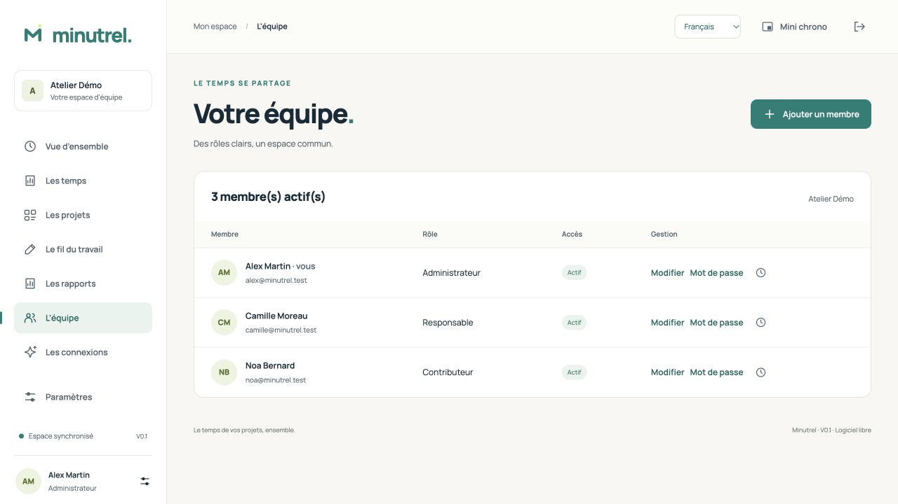

Invitations by email, SSO and project-specific management roles are not part of V0.1. The manager role covers the whole team.

## 4. Projects, subcategories and archiving

Subcategory names are entirely up to you. **Subcategories** opens a blank input with no predefined labels or placeholder. Enter your own name and select **Add**. New projects start with none. Select the project and optional subcategory in the timer or manual-entry form, then describe the work done. Older screenshots may still call this level “Tasks”. See the [subcategory guide](../../SUBCATEGORIES.md).

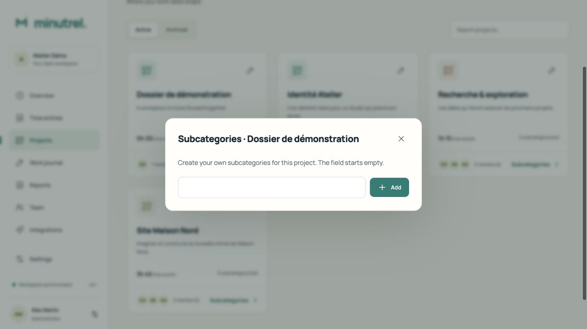

In **Projects**, search or switch between active and archived projects. Managers and administrators create or edit the name, description, colour and assigned members. **Subcategories** adds or archives optional subcategories. Contributors see assigned projects. In a standalone workspace you manage your own projects.

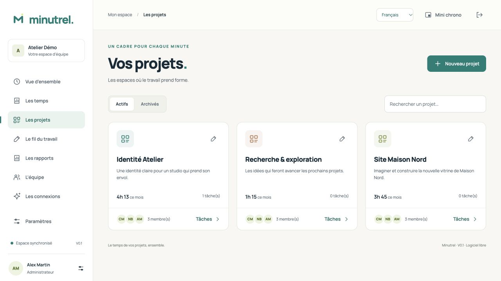

Stop active project timers before archiving. Archiving preserves historical time entries.

## 5. Track time and use the mini timer

In **Overview**, choose a project, optionally a subcategory, describe the work and click **Start**. **Pause** stops counting without finishing the entry; **Resume** continues it. **Finish** saves the completed time. Breaks are excluded.

**Mini timer** opens a movable window above ordinary windows. Desktop also offers a system tray/menu bar icon and `Ctrl/Cmd + Alt + M`, when available. The widget resizes to its content; **Minutrel** opens the main window and the cross hides the widget. Full-screen applications and some Linux/Wayland environments impose their own window rules.

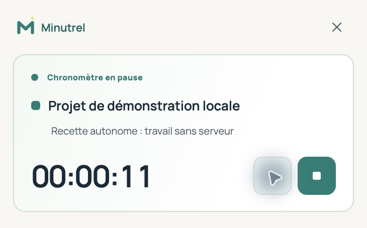

Closing a window or quitting does not finish a timer. Personal timers remain in the local journal; team timers already accepted continue on the server. Computer sleep is not an automatic pause. Finish explicitly when work ends.

On the web, a compact bar remains during navigation. A separate mini window is available when the browser supports Document Picture-in-Picture; otherwise use the bar.

## 6. Work offline and synchronise

| Status | Meaning |
| --- | --- |
| Local workspace | Personal work saved only on this computer |
| Workspace synchronised | Server reachable and no local changes awaiting acceptance |
| Waiting to sync | Time entries saved locally and not yet accepted by the server |
| Offline | Desktop timer actions and new manual entries remain recordable; team administration requires the server |
| Conflict to resolve | The server rejected a version, assignment or overlap; local proposals remain saved |

An initial online connection prepares your account, assigned projects and current timer. After upgrading from an older client, open your team account online once to link the saved cache to the session. The outbox survives closing the app. Sending resumes when the server is reachable; **Settings → Synchronise** retries. An expired session may require signing in again to the same account. Do not delete app data while changes are pending. Opening a team cache after 30 days without account verification requires a connection; the standalone personal workspace has no such deadline.

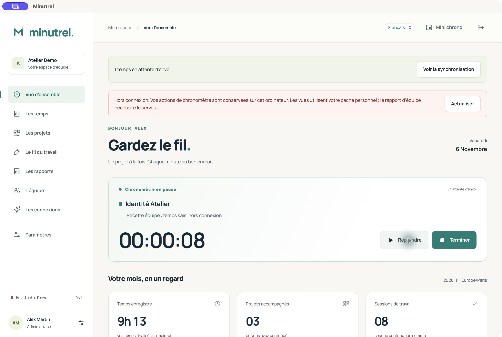

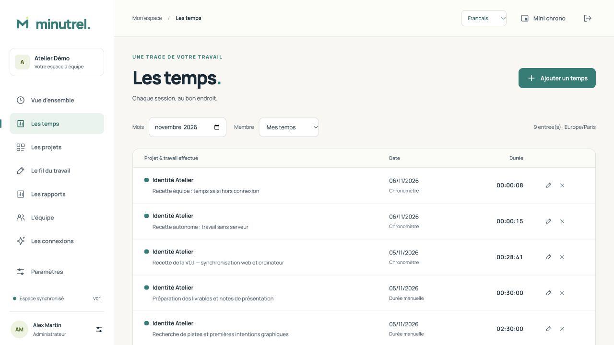

Avoid recording the same interval from several offline devices. The server rechecks permissions, overlapping intervals and the active timer. It never silently replaces another device’s history.

To resolve a conflict, finish the local timer, export a local copy and compare the server state. **Archive the queue and keep the server state** preserves proposals in local archives and reloads the server. Re-enter genuinely missing time manually after checking it. V0.1 does not merge divergent histories automatically. Editing team projects, correcting server entries, team reports and AI configuration need a connection. A cached personal preview is not a complete collective report.

## 7. Transfer personal work to a team

Finish personal timers, open your team account and go to **Settings → Transfer my local work → Read my local workspace**. Map each selected personal project to an existing, authorised team project. Unmapped projects remain local.

Completed entries are copied to your team account; originals stay on the computer. Subcategories are not recreated and private notes are not sent. A repeated transfer recognises entries already received. Keep the same project mapping after the first send; changing it requires resolving a conflict. Personal and team workspaces are not merged automatically, and this is not synchronisation between two teams.

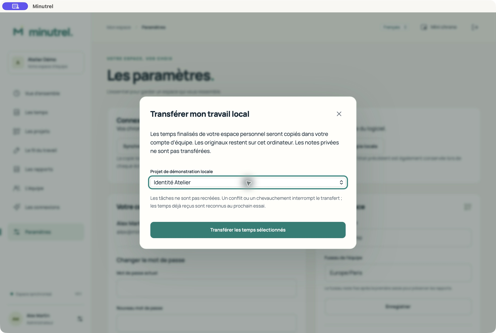

## 8. Manual entries and corrections

**Time entries** filters by month. Managers and administrators can select another member. Lists are paginated; wide tables can scroll horizontally on small screens.

**Add time → Duration** accepts `1h30`, `90 min` or `1.5 h` for today or a past work date, up to 24 hours per entry. **Start and end** accepts a wholly past interval up to seven days, with an explicit UTC offset, such as `+01:00` or `+02:00` in Paris depending on the season. Confirm intentional overlaps; the server checks them again during synchronisation.

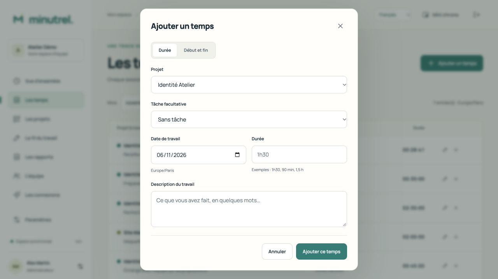

The pencil corrects a completed entry with a reason. **Description** preserves the original segments and seconds. **Duration** or **Start and end** replaces segments; the old value and reason are recorded. The cross removes an entry from reports with a reason. A stale version requires refreshing before another correction. Team corrections require a connection. The standalone correction log retains up to 1,000 recent correction records.

## 9. Notes, summaries and AI

In **Work journal → Add a note**, choose the project, work date and text. A private note is visible only to you and assistants you explicitly permit to read it. **Review / share** controls inclusion in team reports. Deleting a note is permanent and asks for confirmation in the app.

**Write** prepares a manual monthly summary. Use **Review and approve**, edit and approve the text to include it in reports. Drafts stay private.

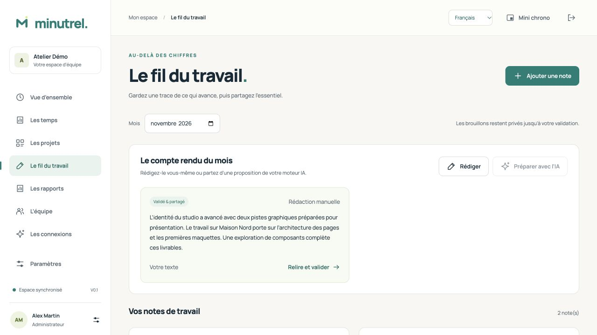

An administrator can configure Ollama, vLLM or Claude under **Integrations**. In **Prepare with AI**, check the displayed address before consenting to send your descriptions and notes, including private notes. If the provider settings change, reopen the form and confirm the recipient again. Review the private draft before approval. AI never changes the calculated time totals. Configure and test your provider on your own infrastructure. In standalone mode you can write notes and summaries manually.

## 10. Monthly reports and exports

In **Reports**, choose the month. Team administrators select employees under **Entire team**, including disabled members’ history, then download **CSV**, **PDF** or **ZIP archive**. Other roles view their own report. Standalone exports contain personal local work.

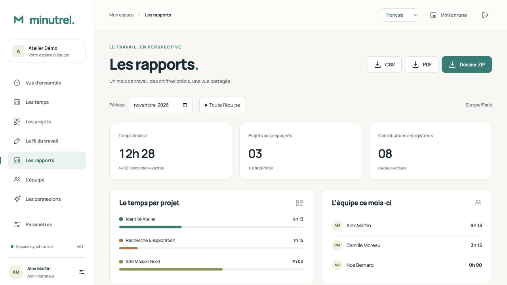

Totals use exact completed seconds, excluding breaks, deleted entries and active timers. Intervals crossing a month boundary are split in the workspace time zone, including daylight-saving changes. Private notes and unapproved summaries are excluded.

CSV uses UTF-8 and semicolons; server report labels follow the selected language, while personal CSV columns remain stable for other tools. PDF is paginated. Team ZIP contains time CSV, project totals, a collective PDF and individual PDFs. Personal ZIP contains CSV, PDF and report JSON.

Server exports are private snapshots, available to the creating administrator for 24 hours. Later corrections do not change that snapshot. Limits: 100 members and 20,000 entries per team export; the on-screen preview shows 100 entries with complete totals. For a definitive team report, first synchronise members’ work and stop active timers.

## 11. Codex, Claude Code, API and webhook

In **Integrations → Create access token**, choose a name, expiry and the smallest set of permissions. Copy the secret once. **Set up my assistant** provides Codex and Claude Code configurations. Store the token in `MINUTREL_MCP_TOKEN`, outside source control. **Revoke** stops access.

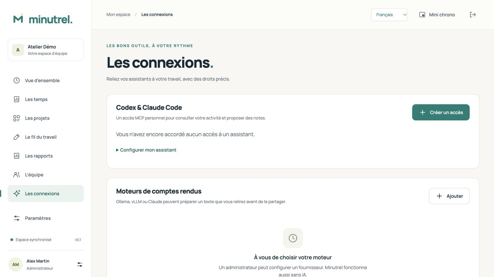

Timer control is a separate permission, disabled by default. Even an administrator’s token is personal. Assistant notes start as private drafts. REST uses application sessions; MCP tokens do not grant general REST or team export access.

An automation tool can call **`POST /hooks/work-notes`** with a token granting `work.draft_own`, a unique `Idempotency-Key`, and `projectId`, `workDate`, `text`. The result is a private note for review, never hours or a shared note. Repeated keys are retained for 30 days. See the [API/webhook contract](../../API_WEBHOOKS.md) for the full HTTP example and error codes. Outgoing webhook subscriptions are not included in V0.1.

## 12. Languages, settings and accessibility

Use **Français / English / Deutsch** on sign-in or in the header. Changing language reloads the interface, so save forms first. Dates and labels change; user content and exact durations do not. Native operating system controls may use the system language.

On smaller screens, navigation becomes a horizontal bar and tables scroll sideways. The skip link, labelled buttons and reduced-motion support help keyboard use. Responsive checks are distinct from a full accessibility audit. [See the mobile screenshot](../../screenshots/10-mobile-de.jpg).

**Settings** contains your password, server address and, for administrators, workspace configuration, shared-work JSON export and the activity log. Password changes revoke previous access. A workspace JSON export is not a full server backup.

## 13. Backup and troubleshooting

For servers, use the [backup/restore procedure](../../../infra/backup/README.md) and [self-hosting guide](../../AUTOHEBERGEMENT.md). Keep the database and encryption key together. For standalone desktop, quit the app and copy its entire configuration folder, including `offline-*.json`, `.bak` and `connection.json`. Typical locations are `~/Library/Application Support/app.minutrel.desktop` on macOS, `%APPDATA%\app.minutrel.desktop` on Windows and `$XDG_CONFIG_HOME/app.minutrel.desktop` or `~/.config/app.minutrel.desktop` on Linux. A JSON copy is also exportable from settings; restoration through the interface is not included.

After restoring a team server, members sign in again. Create new MCP or webhook tokens for the integrations you use.

| Problem | Check |
| --- | --- |
| No projects | Ask for an assignment, or create a personal project |
| Server unreachable | Check URL, HTTPS, certificate and network; AI is not needed for timers |
| Missing report time | Stop the timer; check month, time zone, member and outbox |
| Conflict or revoked rights | Keep local files, export a copy and contact the administrator |
| Missing widget | Use the main window, menu bar icon or mini timer button; check full-screen and shortcut rules |
| AI unavailable | Check provider and allowed hosts; write the summary manually meanwhile |

For a bug report, include version, OS, local/team mode, steps and message. Remove passwords, tokens, private notes and team data from screenshots. Report vulnerabilities through the [security channel](../../../SECURITY.md), without posting exploit details publicly.

[Delivered scope](../../ETAT_V0_1.md) · [Recorded validation](../../VALIDATION_CI.md) · [GitHub publication](../../GITHUB.md). Advanced technical documents are currently maintained in French.

## 14. Project planning and timesheets

These features are available in the development version. The screenshots use fictional data.

### Project overview and actions

1. In **Projects**, select the project name. **Edit project** lets you enter an optional time budget such as `40 h` and a deadline.
2. In **Project overview**, read completed time and remaining budget. Filter the work descriptions and totals by month and subcategory. Managers and administrators can also select a team member. Contributors see their own recorded time.
3. In **Actions → New action**, enter your own title. Choose a subcategory, assignee, planned dates and estimated duration as needed. Managers and administrators can edit the action. An assigned contributor can update its status.
4. In the main timer or manual-entry form, choose the project and the matching subcategory, then select the action if desired. Enter what you did in **Work description**. The linked action appears with the entry and in exports.

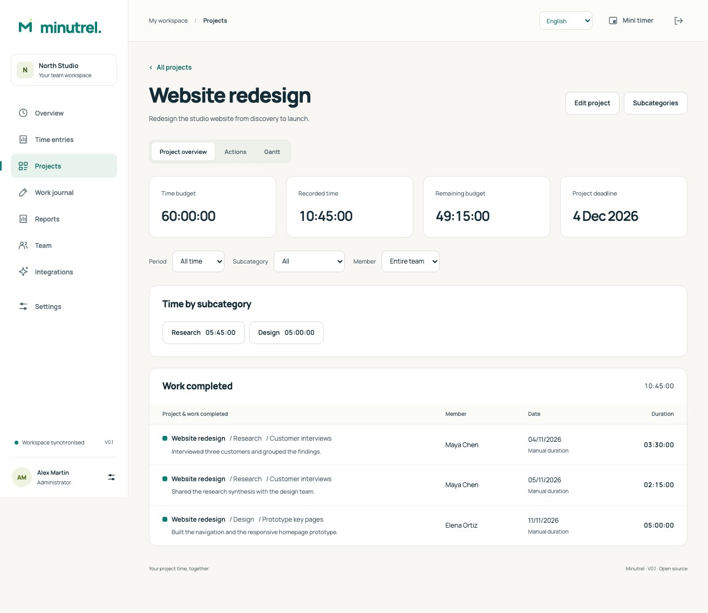

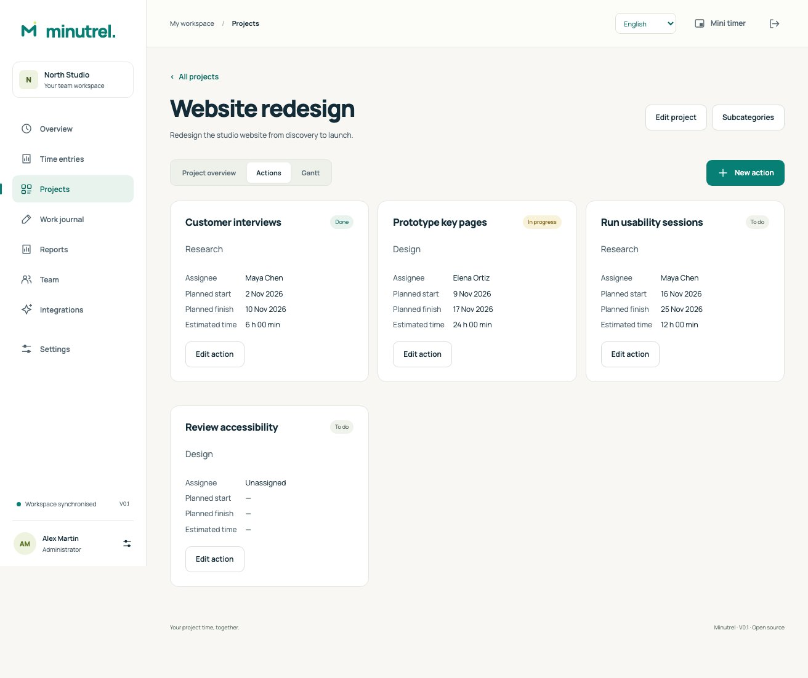

### Gantt and workload

Open **Gantt** within a project. Under **Period**, choose 6 weeks, 3, 6 or 12 months, 3 or 5 years, or **Custom dates**. With custom dates, set **Starting** and **Through**. The arrows move by one displayed period. An action with one date appears on that day. Actions without dates are listed below the chart.

Open **Projects → Workload** to see estimated time for open actions by person across the same period choices. Estimates are spread over the planned Monday-to-Friday days. An action scheduled only for the weekend keeps its estimate on that weekend. Enter a weekly capacity to highlight overload. The view adjusts capacity to the number of working days in each column. Actions that need a date or estimate appear under **Actions to schedule**.

In a team, an administrator can select **Team → Hourly rate** for a member, enter the amount and currency, then save. The workload view multiplies planned hours by the rate and shows the estimated amount in each person's currency. Team rates and amounts are visible to administrators. In a standalone workspace, set your rate under **Settings → Your account**. Clear the amount and save to remove a rate.

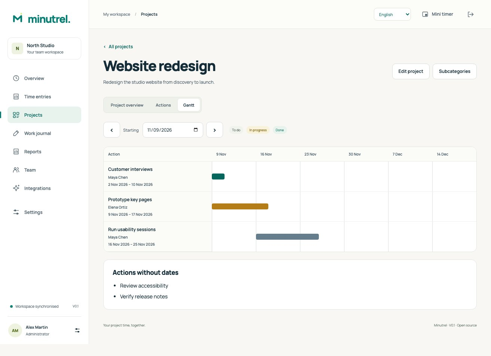

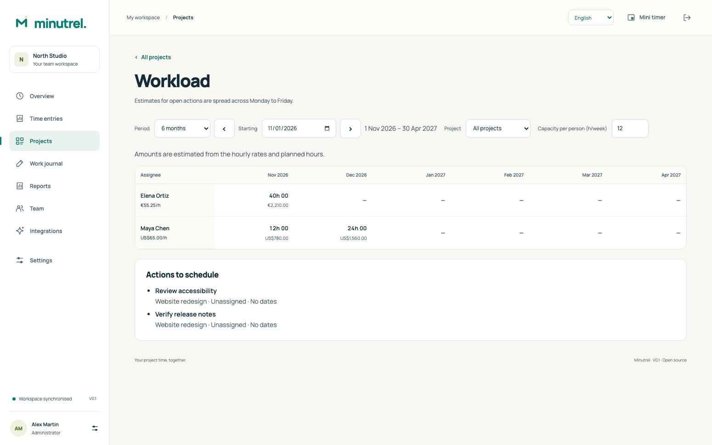

### Weekly review and monthly exports

1. In a team workspace, open **Time entries → Timesheets** and select a week. Finish any timer touching that week and sync pending desktop entries. Select **Submit timesheet** to lock the week's entries for review.
2. As a manager or administrator, select the member and check the entries. Choose **Approve timesheet** or **Return for correction**, with a reason for the return. Returning a submitted or approved sheet reopens its time entries. The member can then edit and submit again.
3. As an administrator, open **Reports**, select the month and optionally the members. Enable **Approved time only**, then download CSV, PDF or ZIP. An entry that spans a week or month boundary contributes only the approved seconds within the selected month. The full report includes shared notes and approved work summaries.

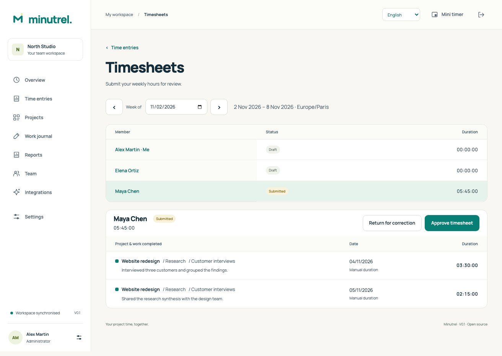

Standalone desktop supports project planning and action links offline. A linked desktop can attach cached actions to offline time entries. Editing team plans, submitting timesheets and reviewing them require the team server.
