# Guide utilisateur — Minutrel V0.1

Vidéos en anglais avec narration, musique et sous-titres : [présentation](https://youtu.be/q6VeUbyOhn8), [premiers pas](https://youtu.be/u5MItUvsxQc) et [les 12 guides vidéo](../../VIDEOS.md).

[Français](README.md) · [English](../en/README.md) · [Deutsch](../de/README.md)

Ce guide couvre les fonctions livrées de la version 0.1.0. Les captures proviennent de l’application et de données fictives. Les textes des projets et des notes ne sont pas traduits automatiquement.

## Choisir votre mode d’utilisation

| Mode | Compte et données | Connexion nécessaire |
| --- | --- | --- |
| Ordinateur autonome | Un espace personnel sur cet ordinateur, sans compte en ligne | Aucune ; projets, chronomètre, saisies, notes, comptes rendus et exports locaux |
| Ordinateur relié à une équipe | Votre compte sur le serveur de l’équipe, avec une copie personnelle locale | Première connexion en ligne ; chronomètre et nouvelles saisies utilisables ensuite hors connexion |
| Navigateur | Votre compte et les données du serveur de l’équipe | Connexion au serveur ; le navigateur n’embarque pas de mode autonome |

L’application ne demande aucun dossier du disque pour chronométrer : vous choisissez toujours un **projet Minutrel**.

## 1. Démarrer sans serveur

Installez le paquet adapté à votre système. Les paquets V0.1 sont des paquets d’essai non signés. À la connexion, choisissez **Utiliser sur cet ordinateur**. Si vous êtes déjà dans une équipe, ouvrez **Paramètres → Ouvrir mon espace personnel**.

Votre espace local s’ouvre sans adresse e-mail, mot de passe ni service en ligne. Il possède un seul profil, protégé par votre session système. **Les projets → Nouveau projet** permet de créer votre premier projet. Le nom de l’espace et son fuseau se règlent dans **Paramètres** ; le fuseau reste fixe après la première saisie.

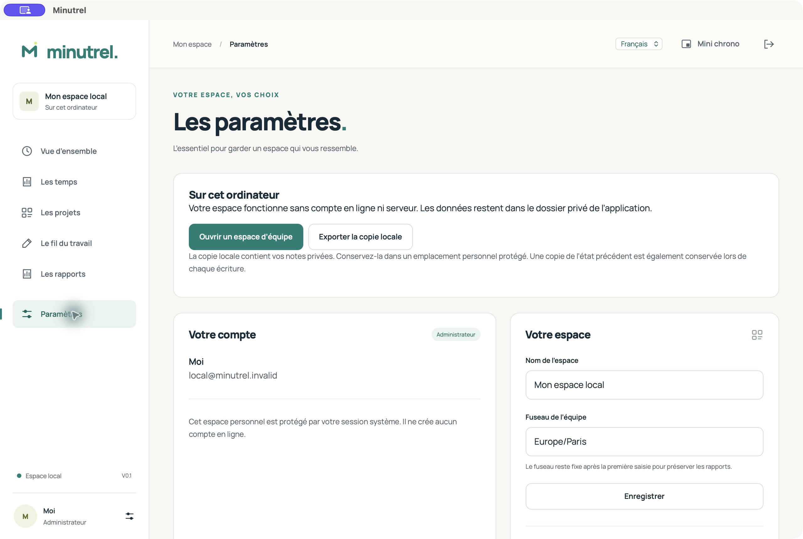

Les données sont écrites dans le dossier privé de l’application, avec une copie de l’état précédent. Elles ne sont pas envoyées à une équipe lorsque vous ouvrez simplement votre espace personnel. Sauvegardez régulièrement ce dossier et utilisez **Exporter la copie locale**. Cette copie contient aussi vos notes privées.

## 2. Rejoindre une équipe

L’administrateur vous fournit l’adresse HTTPS du serveur et votre compte. Ouvrez cette adresse dans votre navigateur. Sur ordinateur, choisissez **Ouvrir un espace d’équipe**, saisissez l’adresse du même serveur et connectez-vous avec le même compte. Une adresse HTTP est acceptée uniquement pour un serveur situé sur cet ordinateur.

Les projets, les droits et les temps de ce compte sont communs aux appareils connectés. Deux espaces sur deux serveurs différents restent distincts. Un espace personnel et un espace d’équipe ne fusionnent pas automatiquement.

## 3. Chronométrer et utiliser le widget

1. Dans **Vue d’ensemble**, choisissez le projet, éventuellement une tâche, et décrivez le travail.
2. Cliquez sur **Démarrer**. **Pause** interrompt le décompte ; **Reprendre** poursuit le même temps.
3. Cliquez sur **Terminer** pour finaliser le temps. Les pauses ne sont jamais ajoutées à la durée.

**Mini chrono** ouvre un widget déplaçable au-dessus des fenêtres ordinaires. Sur ordinateur, l’icône de barre de menus/notification et `Ctrl/Cmd + Alt + M` le proposent également. La hauteur suit le contenu. Le bouton **Minutrel** ramène la fenêtre principale ; la croix masque le widget. Le raccourci et le placement dépendent des règles du système, notamment sur Linux/Wayland et en plein écran.

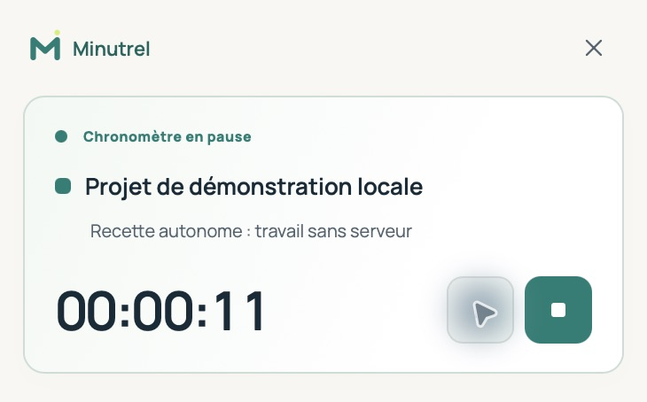

Fermer une fenêtre ou quitter le logiciel ne termine pas un chronomètre. En mode personnel, il reste dans le journal local ; en équipe, un temps déjà reçu continue aussi sur le serveur. Pensez à le terminer explicitement. La veille de l’ordinateur n’est pas une pause automatique.

Dans le navigateur, une barre compacte reste accessible pendant la navigation. La fenêtre externe **Mini chrono** dépend de Document Picture-in-Picture ; à défaut, la barre reste disponible.

## 4. Comprendre la synchronisation

| État | Signification et action |
| --- | --- |
| Espace local | Travail personnel stocké sur cet ordinateur ; aucun serveur requis |
| Espace synchronisé | Serveur joignable et aucune modification locale en attente |
| En attente d’envoi | Une ou plusieurs saisies sont conservées localement avant acceptation du serveur |
| Hors connexion | Chronomètre et nouvelles saisies restent enregistrables sur le client ordinateur ; les fonctions de gestion d’équipe nécessitent le serveur |
| Conflit à résoudre | Le serveur refuse une version, une affectation ou un chevauchement ; les données locales restent conservées |

Une première connexion prépare la liste des projets autorisés et le chronomètre. Après une coupure, les envois reprennent lorsque l’application retrouve le serveur ; **Paramètres → Synchroniser** permet de réessayer. Une session expirée peut demander une reconnexion au même compte. N’effacez pas le dossier local pendant une attente d’envoi.

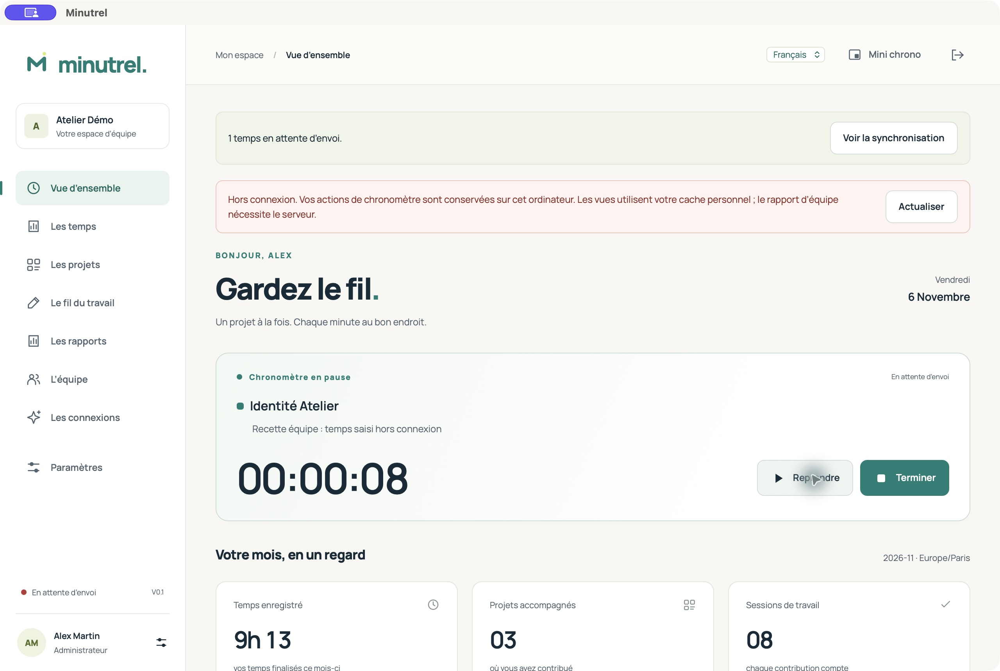

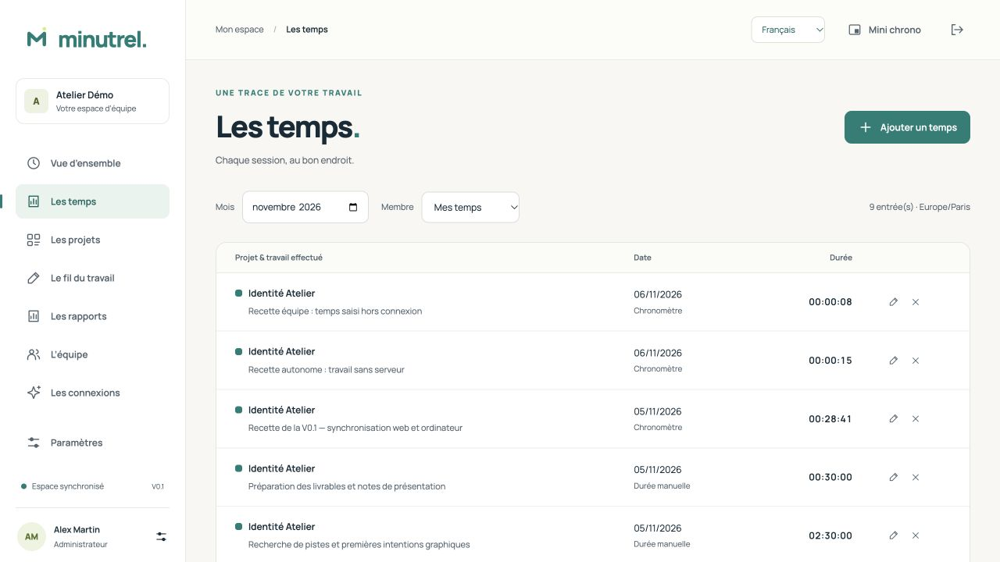

Évitez de travailler sur le même intervalle depuis plusieurs appareils déconnectés. Le serveur refuse les conflits et revalide les droits : une personne désactivée ou retirée d’un projet ne contourne pas cette règle en restant hors connexion.

En cas de conflit, terminez le temps local, exportez la copie, puis consultez l’état du serveur. **Archiver la file et conserver le serveur** garde les propositions dans les archives locales et recharge le serveur. Vous pouvez ensuite réintroduire les durées réellement manquantes par une saisie motivée. La V0.1 n’effectue pas de fusion automatique des conflits. Voir [le fonctionnement détaillé](../../SYNCHRONISATION.md).

## 5. Transférer un travail commencé en autonomie

Terminez vos chronomètres personnels, ouvrez votre compte d’équipe puis **Paramètres → Transférer mon travail local → Lire mon espace local**. Pour chaque projet personnel à transférer, choisissez un projet d’équipe existant et autorisé. Les projets sans correspondance restent locaux.

Seuls les temps finalisés sélectionnés sont copiés dans votre compte. Les originaux restent sur l’ordinateur ; les tâches ne sont pas recréées et les notes privées ne sont pas transférées. Le serveur reconnaît un temps déjà importé lors d’une nouvelle tentative. Gardez la même correspondance de projet après un premier envoi ; un changement est traité comme un conflit. Cette opération ne relie pas deux comptes ou deux équipes entre eux.

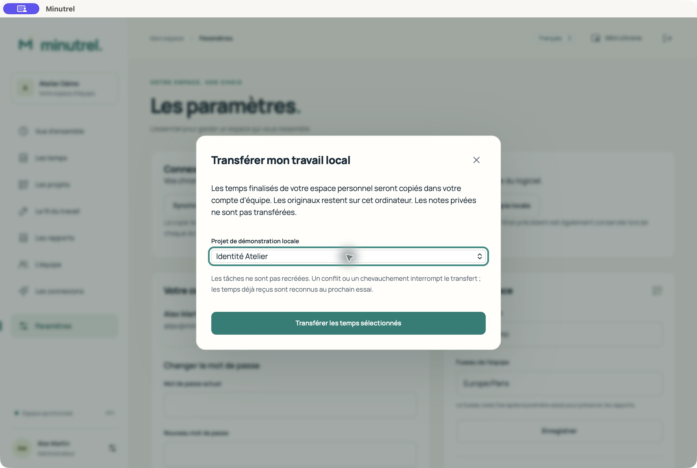

## 6. Gérer les projets et tâches

Dans **Les projets**, recherchez un projet ou passez aux archives. Les responsables et administrateurs créent et modifient les projets, la couleur, la description et les membres affectés. **Tâches** ajoute ou archive les tâches facultatives. Un projet avec un chronomètre actif doit être finalisé avant archivage.

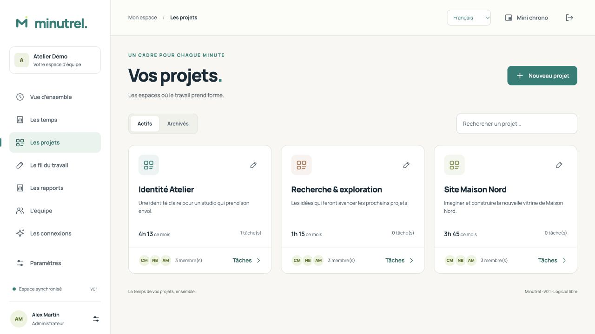

Un contributeur voit ses projets affectés. En mode personnel, vous gérez vos propres projets. Archiver un projet conserve son historique.

## 7. Saisir ou corriger des temps

**Les temps** filtre par mois ; un responsable ou administrateur peut choisir un membre de l’équipe. Les listes sont paginées.

**Ajouter un temps → Durée** accepte par exemple `1h30`, `90 min` ou `1,5 h`, pour une date de travail passée ou présente, jusqu’à 24 h par saisie. **Début et fin** demande un intervalle entièrement passé et un décalage UTC explicite, par exemple `+01:00` ou `+02:00` à Paris selon la saison ; limite de sept jours. Un chevauchement demande confirmation et reste revalidé lors d’une synchronisation.

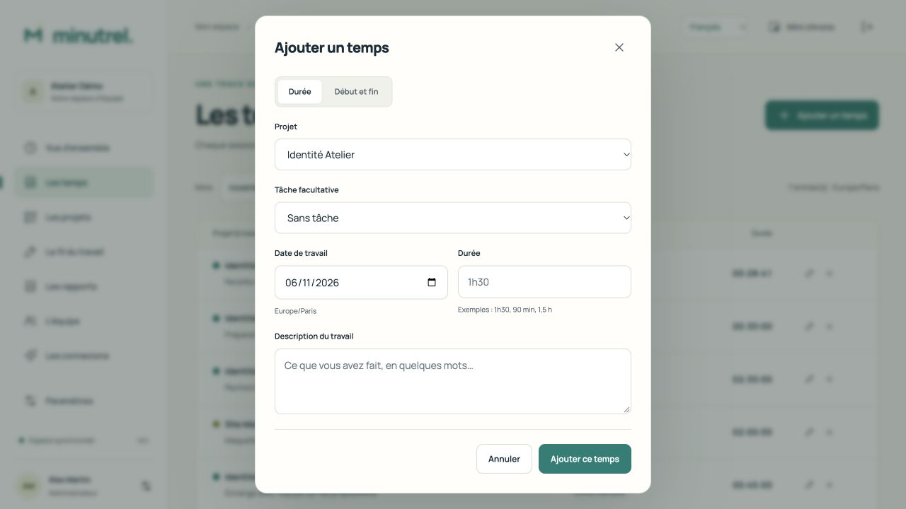

Le crayon permet de corriger une saisie finalisée avec un motif. Choisir **Description** conserve les segments et les secondes d’origine. Changer **Durée** ou **Début et fin** remplace les segments ; l’ancienne valeur et le motif sont conservés dans le journal. La croix retire un temps des rapports avec un motif. Un conflit de version demande d’actualiser avant toute nouvelle correction. Les corrections de temps d’équipe nécessitent la connexion. Le journal personnel garde jusqu’à 1 000 corrections récentes.

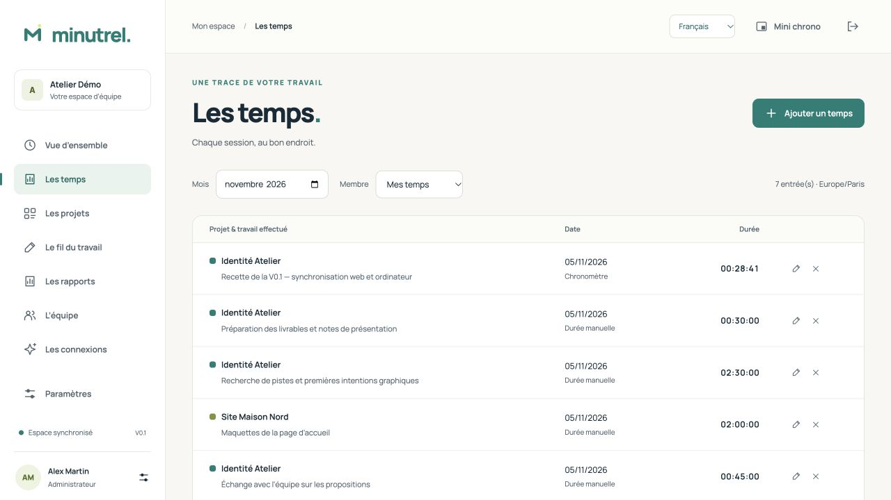

## 8. Ajouter des notes et comptes rendus

**Le fil du travail → Ajouter une note** associe un texte à un projet et une date. Une note privée reste visible par son auteur et les assistants auxquels il a accordé ce droit. Une note partagée peut figurer dans les rapports d’équipe. **Relire / partager** permet de changer ce choix ; la suppression d’une note est définitive et demande confirmation dans l’application.

**Rédiger** prépare un compte rendu mensuel manuel. Ouvrez **Relire et valider**, corrigez le texte et cochez la validation pour l’inclure dans les rapports. Un brouillon reste privé.

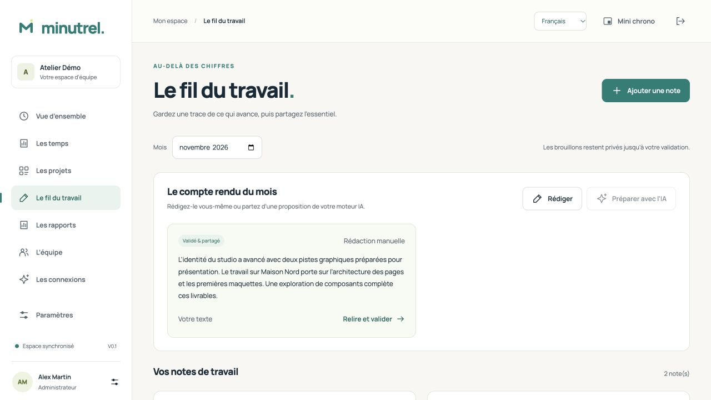

Un administrateur peut configurer un moteur Ollama, vLLM ou Claude dans **Les connexions**. **Préparer avec l’IA** demande le mois, le fournisseur et votre accord pour lui transmettre vos descriptions et notes personnelles, y compris privées. Relisez le résultat. L’IA ne modifie jamais les chiffres de temps. Aucun modèle n’est fourni ou nécessaire. Les connexions IA de la V0.1 utilisent le serveur d’équipe ; le mode autonome permet les notes et comptes rendus manuels.

## 9. Télécharger les rapports

Dans **Les rapports**, choisissez le mois. En équipe, l’administrateur sélectionne les salariés dans **Toute l’équipe**, y compris des comptes désactivés pour leur historique, puis télécharge **CSV**, **PDF** ou **Dossier ZIP**. Les autres rôles consultent leur rapport personnel. En autonomie, ces formats portent sur votre travail local.

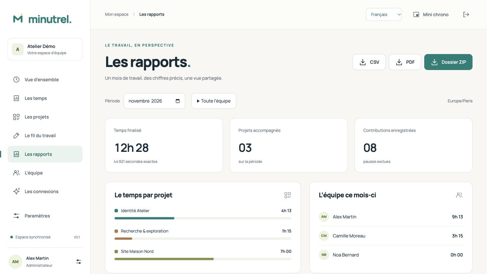

Les totaux additionnent les secondes finalisées, sans pauses ni temps supprimés. Les chronomètres actifs sont signalés séparément. Un intervalle à cheval sur deux mois est réparti dans le fuseau de l’espace. Les notes privées et les comptes rendus non validés sont exclus des rapports.

Le CSV s’ouvre en UTF-8 avec séparateur point-virgule. Le PDF est paginé. Le ZIP d’équipe contient le CSV, les totaux par projet, le PDF collectif et les PDF individuels ; le ZIP personnel contient CSV, PDF et JSON du rapport. Les libellés des rapports serveur suivent la langue choisie ; le CSV personnel conserve des colonnes stables pour l’import dans d’autres outils.

Un export serveur est un instantané privé, téléchargeable pendant 24 h par l’administrateur qui l’a créé. Le corriger ensuite ne change pas cet instantané. Limites : 100 membres et 20 000 temps par export d’équipe ; aperçu d’écran limité à 100 temps, avec totaux complets. Pour un rapport collectif définitif, attendre la synchronisation des membres et terminer leurs chronomètres. Un aperçu local pendant une coupure ne remplace pas ce rapport serveur.

## 10. Administrer les membres

**L’équipe → Ajouter un membre** crée le compte avec son rôle et un mot de passe initial d’au moins 12 caractères, à transmettre par un canal privé. La personne peut le changer dans **Paramètres**. Il n’y a pas encore d’invitation par e-mail ni de SSO.

| Rôle | Droits dans la V0.1 |
| --- | --- |
| Contributeur | Ses temps, notes et rapports personnels ; projets affectés |
| Responsable | Gestion de tous les projets et consultation/correction motivée des temps de l’équipe |
| Administrateur | Droits précédents, comptes, accès, intégrations, exports mensuels collectifs et journal |

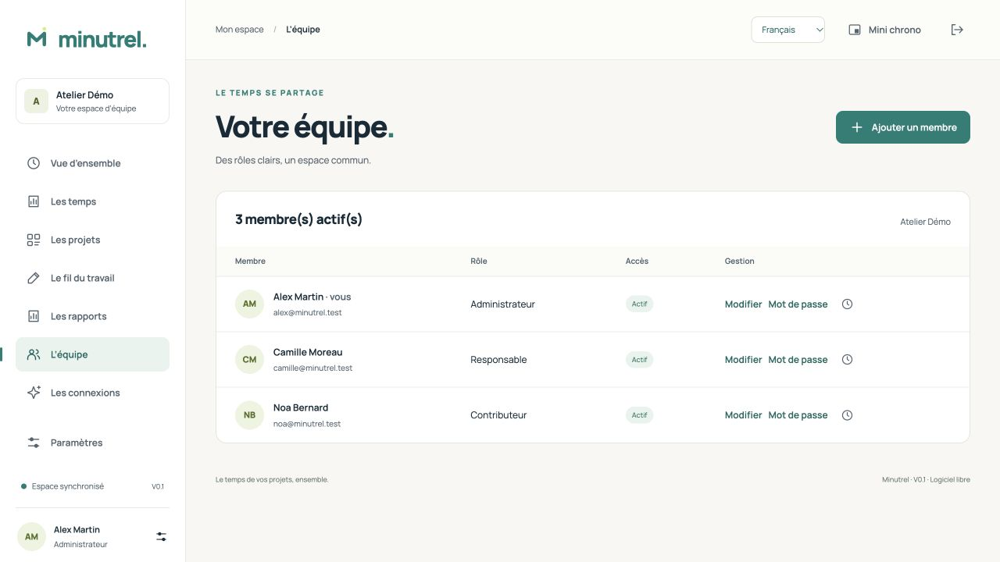

**Modifier** change le rôle ou l’état actif. La désactivation préserve l’historique et révoque les accès. Le dernier administrateur actif ne peut pas être retiré. Avant une désactivation avec un temps actif, finalisez-le. L’icône de chronomètre permet à l’administrateur de résoudre un temps oublié avec un motif ; cette intervention est consignée.

## 11. Connecter Codex, Claude Code ou un webhook

Dans **Les connexions → Créer un accès**, donnez un nom, une durée de validité et seulement les droits nécessaires. Le secret est affiché une seule fois. **Configurer mon assistant** fournit les exemples Codex et Claude Code. Placez le jeton dans `MINUTREL_MCP_TOKEN`, hors du dépôt de code. **Révoquer** coupe cet accès.

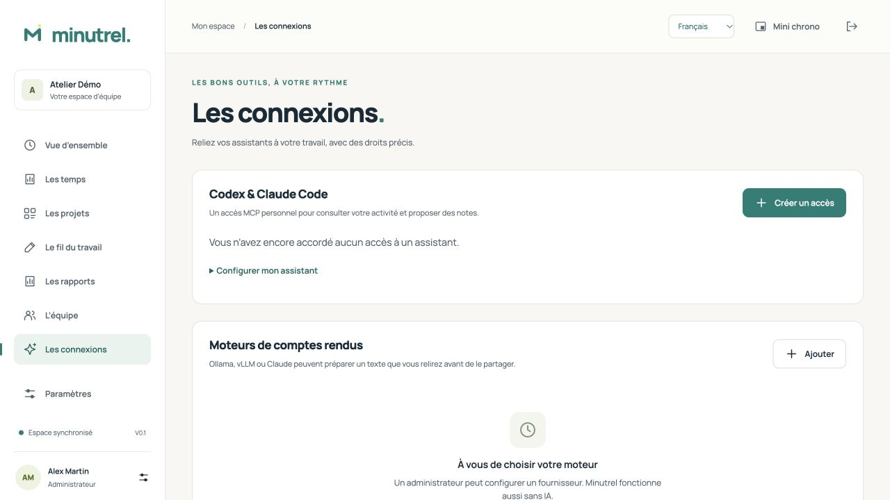

Le droit de commande du chronomètre est facultatif et non coché par défaut. Même le jeton d’un administrateur reste limité à ses données personnelles. Les propositions de notes restent privées.

Un outil d’automatisation peut appeler le webhook entrant **`POST /hooks/work-notes`** avec un jeton ayant `work.draft_own` et une clé d’idempotence. Il ne crée ni heures ni note partagée. Le [guide API/webhook](../../API_WEBHOOKS.md) donne le format et l’authentification. Les webhooks sortants et les abonnements à des événements ne sont pas livrés dans cette version.

## 12. Paramètres, langues et petit écran

Le sélecteur **Français / English / Deutsch** est présent sur la connexion et dans l’en-tête. Il recharge l’interface : validez vos formulaires avant de changer. Les dates et les libellés changent ; vos notes, descriptions, identifiants et durées restent intacts. Les menus ou sélecteurs propres au système peuvent suivre la langue du système.

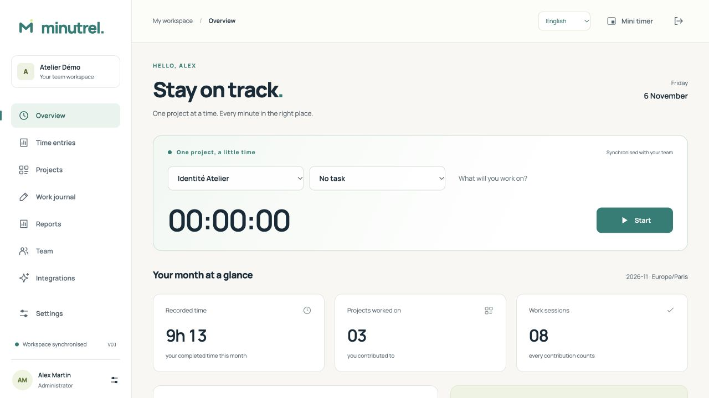

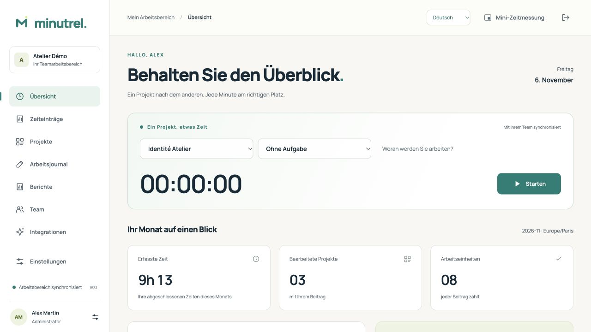

L’interface adapte ses panneaux aux petits écrans. La navigation devient une barre horizontale et les tableaux peuvent défiler horizontalement pour atteindre la durée et les actions. Le lien **Aller au contenu**, les intitulés des boutons et la réduction des animations facilitent l’usage clavier. La recette ne constitue pas un audit d’accessibilité complet.

[Voir la capture mobile complète](../../screenshots/10-mobile-de.jpg).

Dans **Paramètres**, changez le mot de passe, consultez votre adresse de serveur et, si vous êtes administrateur, gérez le nom de l’espace, l’export JSON du travail partagé et le journal. Un changement de mot de passe révoque les accès antérieurs. Le JSON de portabilité ne remplace pas une sauvegarde complète du serveur.

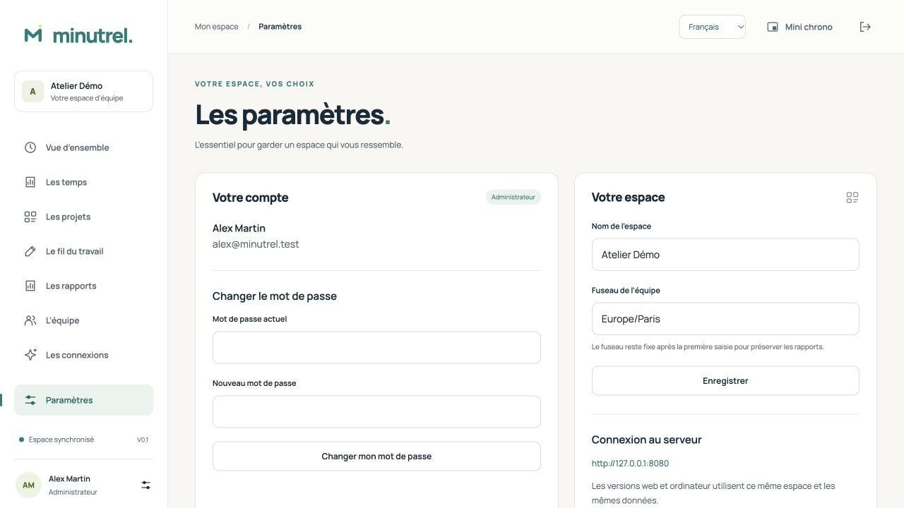

## 13. Sauvegarder, dépanner et trouver de l’aide

Pour le serveur, suivez [sauvegarde/restauration](../../../infra/backup/README.md) et [autohébergement](../../AUTOHEBERGEMENT.md). Sauvegardez la base et sa clé ensemble. Pour le client autonome, quittez l’application puis copiez son dossier de configuration complet, fichiers `offline-*.json`, `.bak` et `connection.json` compris. Les emplacements usuels sont `~/Library/Application Support/app.minutrel.desktop` sur macOS, `%APPDATA%\app.minutrel.desktop` sur Windows et `$XDG_CONFIG_HOME/app.minutrel.desktop` ou `~/.config/app.minutrel.desktop` sur Linux. Une copie JSON peut aussi être préparée dans les paramètres ; l’import par l’interface n’est pas livré.

| Problème | Vérification |
| --- | --- |
| Aucun projet | Demander une affectation, ou créer un projet dans l’espace personnel |
| Serveur introuvable | Vérifier l’adresse, HTTPS et le certificat ; les moteurs IA ne sont pas nécessaires au chronomètre |
| Temps absent du rapport | Terminer le chronomètre, vérifier le mois, le fuseau, le membre et la file d’envoi |
| Droit perdu au retour en ligne | Le serveur a réévalué le compte ou l’affectation ; conserver la copie locale et contacter l’administrateur |
| Conflit | Ne pas effacer les fichiers ; exporter, comparer et archiver la file avant correction |
| Widget absent | Utiliser **Mini chrono**, l’icône système ou la fenêtre principale ; vérifier les restrictions de plein écran/raccourci |
| IA indisponible | Vérifier le fournisseur et les hôtes autorisés ; rédiger manuellement en attendant |

Pour un signalement, indiquez la version, le système, le mode local/équipe, les étapes et le message. Masquez mots de passe, jetons, notes privées et données d’équipe dans les captures. Une vulnérabilité se signale par le [canal de sécurité](../../../SECURITY.md), pas dans une issue publique détaillée.

[État livré](../../ETAT_V0_1.md) · [Validation réellement exécutée](../../VALIDATION_CI.md) · [Préparer une publication GitHub](../../GITHUB.md).
